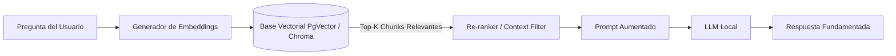

# Skill: Especialista en Inteligencia Artificial Local, Agentes y Arquitecturas RAG

Esta habilidad provee los patrones de diseño y estándares de ingeniería para desplegar, conectar y orquestar Modelos de Lenguaje (LLMs) locales, servidores MCP y flujos agénticos avanzados.

---

## 🖥️ 1. Infraestructura de Modelos Locales (Ollama / vLLM)

### Buenas Prácticas de Selección de Modelos
* **Tareas de Razonamiento y Código:** Modelos especializados como `qwen2.5-coder` (7B / 14B / 32B), `deepseek-coder` o `llama3.3` cuantizados a 4 o 8 bits (GGUF `Q4_K_M` o `Q8_0`) según la VRAM disponible.
* **Embeddings Locales:** `bge-m3`, `nomic-embed-text` o `all-minilm-l6-v2` para búsqueda semántica multilingüe de alta velocidad.
* **Configuración de Context Window:** Establecer adecuadamente `num_ctx` en Ollama (ej. 8192 o 16384 tokens) balanceando consumo de memoria y retención de contexto.

---

## 📚 2. Arquitectura RAG (Retrieval-Augmented Generation)

### Reglas de Segmentación (Chunking)
* **Tamaño de Chunk Óptimo:** Entre 300 y 600 tokens con un solapamiento (*overlap*) del 10-15% para no perder contexto entre cortes de párrafos.
* **Preservación de Metadatos:** Cada vector debe incluir en sus metadatos la fuente original (`source`), fecha (`timestamp`), título de sección (`heading`) y número de página o línea.

---

## 🔌 3. Integración con MCP (Model Context Protocol)

* **Definición de Tools:**
  * Describir detalladamente cada tool y sus argumentos con esquemas JSON Schema explícitos.
  * El LLM debe saber no solo **qué** hace la herramienta, sino **cuándo** y **por qué** invocarla.
* **Manejo Seguro de Ejecución:**
  * Validar parámetros antes de ejecutar llamadas a sistemas de archivos, bases de datos o comandos de terminal.
  * Retornar siempre respuestas estructuradas en JSON o texto plano bien delimitado.

---

## 🎯 4. Prompt Engineering para Agentes Locales
* **Instrucción de Rol:** Definir claramente el rol, las restricciones de formato (JSON estricto vs Markdown) y la política ante dudas ("Si la información no está en el contexto, di 'No dispongo de esa información'").
* **Few-Shot Examples:** Incluir 1 o 2 ejemplos de entrada y salida esperada para modelos menores a 14B para maximizar la fidelidad al formato.
