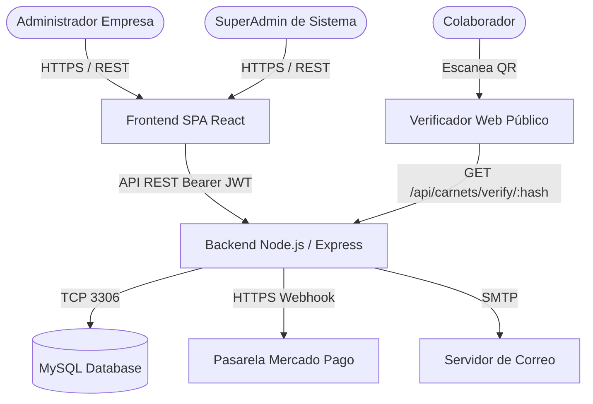

# 🏛️ arc42 Software Architecture Documentation Standard (Master Guide)

El estándar **arc42** (desarrollado por los Dres. Gernot Starke y Peter Hruschka) es la estructura de documentación de arquitectura de software más respetada y utilizada a nivel mundial. Cumple plenamente con el estándar internacional **ISO/IEC/IEEE 42010** para la descripción de arquitecturas de sistemas y software.

Su filosofía central es: **comunicar eficazmente la arquitectura a todas las partes interesadas mediante una estructura lógica, pragmática y sin redundancias**.

---

## 🗺️ Mapa Estructural de las 12 Secciones arc42

```
+-----------------------------------------------------------------------------------+
|                           ESTRUCTURA MAESTRA ARC42                                |
+-----------------------------------------------------------------------------------+
| 1. Introducción y Metas          | Requerimientos clave, metas de calidad, stakeholders |
| 2. Restricciones de Arquitectura | Limitaciones técnicas, legales y organizacionales   |
| 3. Contexto y Alcance            | Contexto de negocio y contexto técnico del sistema  |
| 4. Estrategia de Solución        | Decisiones fundamentales y patrones de diseño       |
| 5. Vista de Bloques de Construcc.| Descomposición estática (C4 Niveles 1, 2 y 3)      |
| 6. Vista de Ejecución (Runtime)  | Flujos dinámicos, secuencias e interacciones        |
| 7. Vista de Despliegue           | Infraestructura física, contenedores, redes y cloud |
| 8. Conceptos Transversales       | Seguridad, persistencia, caching, observabilidad    |
| 9. Decisiones de Arquitectura    | Registro formal de decisiones (ADRs vinculados)     |
| 10. Requerimientos de Calidad    | Árbol de calidad y escenarios de prueba ATAM       |
| 11. Riesgos y Deuda Técnica      | Vulnerabilidades, cuellos de botella y mitigaciones |
| 12. Glosario                     | Lenguaje ubicuo, acrónimos y definiciones técnicas  |
+-----------------------------------------------------------------------------------+
```

---

## 📋 Guía Detallada Sección por Sección

### Sección 1: Introducción y Metas
* **1.1 Visión General del Sistema:** ¿Qué problema resuelve el software? ¿Quiénes son los usuarios finales?
* **1.2 Metas de Calidad Prioritarias (Top 3 a 5):**
  | Prioridad | Meta de Calidad (ISO 25010) | Motivación y Métrica Concreta |
  | :---: | :--- | :--- |
  | 1 | **Seguridad & Aislamiento (Multi-Tenancy)** | Cero fuga de datos entre empresas cliente en consultas SQL (IDOR). |
  | 2 | **Rendimiento & Baja Latencia** | Verificación pública de credenciales QR en menos de 200 ms (p95). |
  | 3 | **Disponibilidad & Resiliencia** | SLA del 99.9% mensual con recuperación ante fallos en menos de 5 min. |
* **1.3 Tabla de Partes Interesadas (Stakeholders):**
  | Rol / Stakeholder | Expectativas Principales |
  | :--- | :--- |
  | **Dirección TIC / CTO** | Estabilidad de infraestructura, bajo costo operativo y blindaje de seguridad. |
  | **Talento Humano / Empresas** | Agilidad en la emisión de carnets, personalización visual y facilidad de uso. |
  | **Desarrolladores & QA** | Código desacoplado, modularidad en capas y APIs estrictamente documentadas. |

---

### Sección 2: Restricciones de Arquitectura
Documenta todas las limitaciones impuestas externamente que el equipo de desarrollo no puede cambiar:
* **Restricciones Técnicas:** Servidor en Node.js v20+, base de datos relacional MySQL 8+, navegador con soporte HTML5 Canvas.
* **Restricciones Organizacionales:** Presupuesto de nube acotado, equipo de desarrollo distribuido, plazos de entrega.
* **Restricciones Legales y Normativas:** Ley de Protección de Datos Personales (Habeas Data / GDPR), retención de bitácoras por 12 meses.

---

### Sección 3: Contexto y Alcance
Delimita las fronteras del sistema respecto a su entorno externo:
* **3.1 Contexto de Negocio:** Diagrama que muestra a los actores humanos y sistemas externos interactuando con la plataforma.
* **3.2 Contexto Técnico:** Protocolos de comunicación física (HTTPS, Webhooks, REST JSON, WebSockets, SMTP).



---

### Sección 4: Estrategia de Solución
Describe las decisiones estructurales fundamentales adoptadas para cumplir los objetivos:
1. **Separación Frontend/Backend desacoplada:** SPA en React 19 optimizada con Vite comunicándose mediante API REST JSON contra Express 5.
2. **Arquitectura Multi-Inquilino de Esquema Compartido:** Segregación lógica en todas las tablas mediante `company_id` y contexto asíncrono con `AsyncLocalStorage`.
3. **Motor Gráfico en el Cliente (Client-Side Canvas Rendering):** Generación y exportación de carnets a 300 DPI directamente en el navegador del usuario para no sobrecargar de renderizado de imagen la CPU del servidor.
4. **Criptografía Asimétrica/Hashing para QRs:** Uso de hashes SHA-256 no secuenciales para neutralizar ataques de enumeración y falsificación.

---

### Sección 5: Vista de Bloques de Construcción (Building Block View)
Descomposición estática del sistema en módulos y componentes (alineada con el modelo C4):
* **Nivel 1 (Caja Blanca del Sistema Global):**
  * Frontend SPA (React): Módulos Public, System y Company.
  * Backend API (Express): Capas Config, Middleware, Routes, Controllers, Services, Models, Utils.
  * Base de Datos (MySQL): Tablas Core, Tenant y Sistema.
* **Nivel 2 (Sub-bloques del Backend):**
  * Desglose de controladores y su delegación en la capa de servicios.
* **Nivel 3 (Detalle de Componentes Críticos):**
  * Motor `planLimits.js`, autenticación unificada `authService.js`, seeder `initializeSystemData.js`.

---

### Sección 6: Vista de Ejecución (Runtime View)
Ilustra el comportamiento dinámico del sistema ante los casos de uso más críticos mediante diagramas de secuencia:
* **Escenario 1:** Inicio de sesión unificado y retorno de branding.
* **Escenario 2:** Creación de colaborador, subida de foto multipart y verificación de límites.
* **Escenario 3:** Emisión de carnet con QR criptográfico SHA-256.
* **Escenario 4:** Notificación IPN de Mercado Pago con verificación de firma HMAC y activación de suscripción.

---

### Sección 7: Vista de Despliegue (Deployment View)
Mapeo de los componentes de software sobre la infraestructura física o de nube:
* **Entornos:** Desarrollo local (`localhost`), Staging (VPS de pruebas) y Producción (Docker / Cloud / Nginx Reverse Proxy).
* **Nodos de infraestructura:**
  * **Nodo Web / Reverse Proxy:** Nginx con terminación SSL/TLS Let's Encrypt y compresión Brotli/Gzip.
  * **Nodo de Aplicación:** Contenedor Node.js v20 ejecutando Express mediante PM2 o Docker Compose.
  * **Nodo de Base de Datos:** Instancia MySQL 8 con almacenamiento SSD, backups automatizados diarios y pool de conexiones controlado.
  * **Nodo de Almacenamiento:** Volúmenes montados persistentes para `/src/uploads`.

---

### Sección 8: Conceptos Transversales (Cross-cutting Concepts)
Directrices arquitectónicas que aplican horizontalmente a todo el sistema:
* **Modelo de Dominio:** Entidades principales y relaciones de multiplicidad.
* **Seguridad y Ciberseguridad:** Cabeceras Helmet, políticas CORS sin comodines, protección XSS, contraseñas hasheadas con Bcrypt (costo 10), tokens JWT con expiración estricta.
* **Manejo Uniforme de Excepciones:** Middleware centralizado con clase `AppError`, respuestas JSON normalizadas `{ success: false, message, data: null }`.
* **Observabilidad y Trazabilidad:** Winston Logger estructurado en JSON, Request-ID único correlacionado (`x-request-id`), rotación de archivos diarios.
* **Estrategia de Caché:** Capa en memoria RAM (`node-cache`) con políticas TTL para parámetros de lectura intensiva.

---

### Sección 9: Decisiones de Arquitectura (Architecture Decisions - ADRs)
Registro cronológico de las decisiones técnicas más relevantes tomadas a lo largo del proyecto, enlazadas a los archivos de ADR individuales en `docs/adr/`.
* *ADR-001:* Adopción de MySQL con Sequelize en lugar de MongoDB.
* *ADR-002:* Uso de AsyncLocalStorage para propagación de contexto multi-inquilino.
* *ADR-003:* Renderizado de credenciales con Canvas API en cliente en lugar de Puppeteer en servidor.
* *ADR-004:* Adopción de Express 5 por su soporte nativo de promesas asíncronas.

---

### Sección 10: Requerimientos de Calidad
Estructura los requerimientos no funcionales mediante un **Árbol de Calidad** y **Escenarios ATAM** (Architecture Tradeoff Analysis Method):
* **Escenario de Seguridad:** Un usuario autenticado de la Empresa A intenta acceder al endpoint `GET /api/colaboradores?company_id=B`. El backend detecta la discrepancia con el token JWT y responde `403 Forbidden` en menos de 50 ms registrando un intento de intrusión en la bitácora.
* **Escenario de Escalabilidad:** 200 usuarios concurrentes escanean carnets QR simultáneamente en un evento masivo. El endpoint de verificación pública responde el 100% de las consultas con código 200 OK y tiempo de respuesta inferior a 150 ms utilizando caché en memoria.

---

### Sección 11: Riesgos y Deuda Técnica
Identificación proactiva de debilidades del sistema con su plan de remediación:
| ID | Riesgo / Deuda Técnica Identificada | Impacto | Probabilidad | Estrategia de Mitigación |
| :---: | :--- | :---: | :---: | :--- |
| **R-01** | Saturación de disco por subida masiva de fotos de colaboradores. | Alto | Medio | Implementar compresión automática WebP en upload y migración a almacenamiento S3/Cloud Storage. |
| **R-02** | Dependencia de proceso único en Node.js ante picos de tráfico. | Medio | Medio | Configurar PM2 en modo Cluster o escalamiento horizontal con réplicas Docker. |
| **R-03** | Latencia en consultas de analítica conforme crezca la tabla `carnets`. | Medio | Alto | Crear índices compuestos B-Tree sobre `(company_id, status, created_at)`. |

---

### Sección 12: Glosario
Define el vocabulario técnico y del dominio de negocio (Lenguaje Ubicuo) para evitar ambigüedades entre desarrolladores y stakeholders:
* **Tenant (Inquilino):** Empresa u organización cliente suscrita al SaaS cuyos datos están completamente aislados del resto.
* **Carnet Digital:** Credencial virtual de identificación con atributos del colaborador, fotografía y código QR verificable.
* **QR Hash:** Cadena alfanumérica única calculada con SHA-256 que actúa como identificador criptográfico del carnet en el mundo exterior.
* **Canvas API:** Interfaz nativa de HTML5 para renderizar gráficos bidimensionales pixel-perfect en el navegador.
* **Checkout Pro:** Modal de pago alojado por Mercado Pago que permite procesar tarjetas, transferencias y pagos en efectivo.
