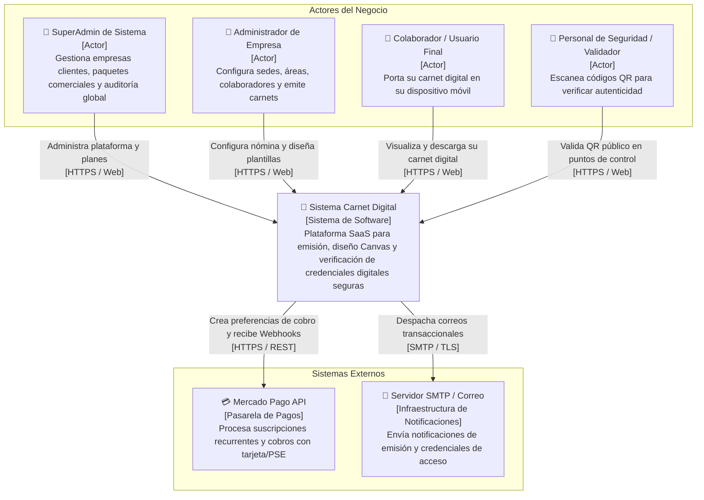
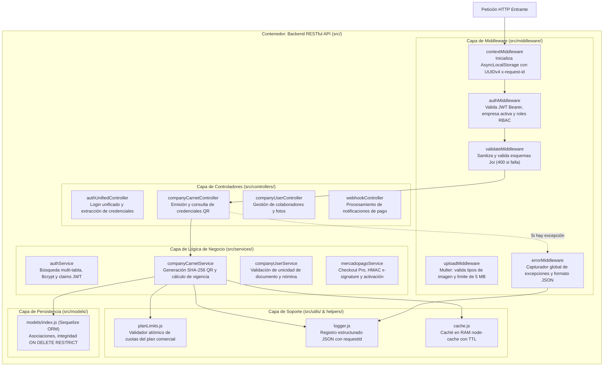
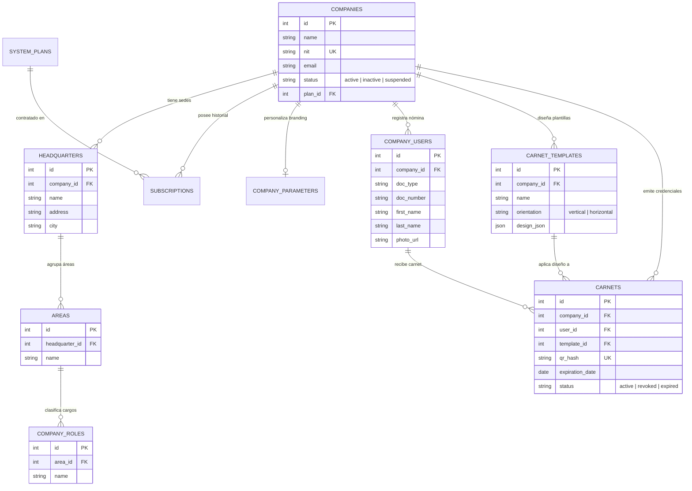

# 📐 C4 Model & Mermaid Architecture Diagrams (Master Specification)

El **Modelo C4** (creado por Simon Brown) es el enfoque estándar de la industria para visualizar y comunicar la arquitectura de software. Funciona exactamente igual que los mapas de navegación geográfica (Google Maps), ofreciendo cuatro niveles progresivos de zoom:

1. **Nivel 1: Contexto del Sistema (System Context):** El mapa mundial. Muestra las personas y los sistemas externos.
2. **Nivel 2: Contenedores (Containers):** El mapa de la ciudad. Muestra las aplicaciones desplegables, bases de datos y microservicios.
3. **Nivel 3: Componentes (Components):** El mapa del vecindario. Descompone un contenedor individual en sus módulos y controladores.
4. **Nivel 4: Código (Code):** El plano del edificio. Muestra clases, entidades relacionales o máquinas de estado.

---

## 🎯 Reglas de Oro de los Diagramas C4

1. **Cada elemento debe tener 3 partes:**
   - **Nombre:** Qué es (ej. `Backend API`).
   - **Tipo o Tecnología:** En qué está construido (ej. `[Contenedor: Node.js / Express]`).
   - **Responsabilidad:** Qué hace en una frase concisa (ej. `Gestiona autenticación, lógica de carnetización y límites`).
2. **Cada flecha / relación debe tener:**
   - **Acción unidireccional:** Un verbo en presente (ej. `Consulta credenciales`, `Envía pagos`).
   - **Protocolo de comunicación:** Entre corchetes o paréntesis (ej. `[HTTPS / JSON]`, `[TCP / 3306]`).
3. **Cero cajas misteriosas:** Ninguna caja puede llamarse simplemente "Servidor" o "Módulo" sin tecnología ni propósito.

---

## 🏗️ Implementación de los 4 Niveles en Mermaid.js

### 🌐 Nivel 1: Diagrama de Contexto del Sistema (System Context)
* **Audiencia:** Directores de tecnología, gerentes de producto, arquitectos y nuevos miembros del equipo.
* **Propósito:** Mostrar los límites del software y cómo interactúan los diferentes tipos de usuarios y servicios externos.



---

### 📦 Nivel 2: Diagrama de Contenedores (Container Diagram)
* **Audiencia:** Desarrolladores backend, frontend, devops e ingenieros de seguridad.
* **Propósito:** Desglosar el sistema en sus unidades de despliegue independientes (aplicaciones cliente, APIs, almacenes de datos).

```mermaid
graph TB
    actor Admin as "👤 Administrador / Usuario"
    actor PublicUser as "👤 Lector de QR / Vigilante"

    subgraph CarnetDigitalBoundary["Frontera del Sistema: Carnet Digital"]
        FrontendApp["💻 Single Page Application (SPA)<br/>[Contenedor: React 19 / Vite]<br/>Interfaz reactiva multi-rol con motor gráfico Canvas para diseño y exportación de carnets a 300 DPI"]
        
        ReverseProxy["🛡️ Reverse Proxy & Edge<br/>[Contenedor: Nginx]<br/>Terminación SSL/TLS, compresión Brotli/Gzip y mitigación básica de DDoS"]
        
        BackendAPI["⚙️ Backend RESTful API<br/>[Contenedor: Node.js 20 / Express 5]<br/>Procesa lógica de negocio, autenticación JWT, RBAC multi-inquilino y control de cuotas"]
        
        MySQLDB[("🗄️ Base de Datos Relacional<br/>[Contenedor: MySQL 8 / InnoDB]<br/>Persiste usuarios, empresas, suscripciones, sedes, plantillas y carnets emitidos")]
        
        FileStorage["📁 Almacenamiento Local Particionado<br/>[Contenedor: File System /uploads]<br/>Guarda imágenes de logotipos corporativos y banners del sistema"]
        
        CronScheduler["⏰ Tareas Nocturnas Cron<br/>[Contenedor: node-cron en Node.js]<br/>Ejecuta verificación diaria de suscripciones a las 00:05 AM"]
    end

    subgraph Externo["Pasarelas Externas"]
        MercadoPagoAPI["💳 Mercado Pago API<br/>[Servicio Externo]"]
    end

    Admin -->|"Interactúa con la interfaz<br/>[HTTPS]"| FrontendApp
    PublicUser -->|"Escanea QR y abre URL de validación<br/>[HTTPS]"| FrontendApp
    
    FrontendApp -->|"Peticiones API con token Bearer JWT<br/>[HTTPS / JSON]"| ReverseProxy
    ReverseProxy -->|"Proxy pass inverso<br/>[HTTP / 4000]"| BackendAPI
    
    BackendAPI -->|"Consultas SQL, transacciones ACID y pooling<br/>[TCP / 3306]"| MySQLDB
    BackendAPI -->|"Lee y escribe fotos y logotipos<br/>[File I/O]"| FileStorage
    BackendAPI -->|"Crea checkout y valida firmas HMAC x-signature<br/>[HTTPS / REST]"| MercadoPagoAPI
    
    CronScheduler -->|"Consulta vencimientos y suspende morosos<br/>[In-process / Sequelize]"| MySQLDB
```

---

### 🧩 Nivel 3: Diagrama de Componentes (Component Diagram - Backend API)
* **Audiencia:** Ingenieros de software y arquitectos trabajando directamente sobre el código fuente de `src/`.
* **Propósito:** Mostrar los módulos internos del backend y cómo colaboran en el ciclo de vida de una petición.



---

### 💻 Nivel 4: Diagrama de Código / Entidades Relacionales (Code / Entity Diagram)
* **Audiencia:** Desarrolladores implementando migraciones, consultas Sequelize o nuevos módulos.
* **Propósito:** Mostrar las relaciones relacionales de multiplicidad e integridad referencial.



---

## ✅ Checklist de Validación para Diagramas C4

- [ ] ¿El diagrama incluye un título claro y explícito que indique su nivel (C4 Nivel 1, 2, 3 o 4)?
- [ ] ¿Todas las cajas contienen Nombre, Tipo/Tecnología y Responsabilidad?
- [ ] ¿Las flechas indican la dirección del flujo de datos con verbo y protocolo?
- [ ] ¿El diagrama se renderiza correctamente en Mermaid sin errores de sintaxis?
- [ ] ¿Se evita mezclar niveles (ej. no colocar funciones de JavaScript dentro de un diagrama de contexto de Nivel 1)?
