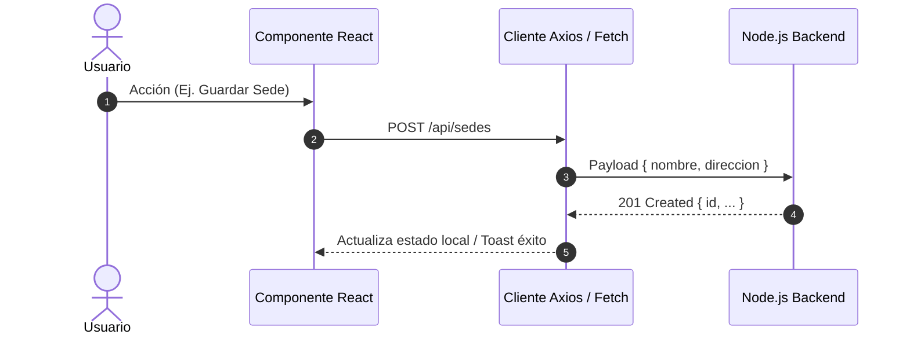

# Skill: Especialista en Documentación Técnica y Arquitectura

Esta habilidad establece las directrices para documentar el código fuente, la arquitectura modular y las integraciones del frontend de **CoreCredential**, priorizando la concisión, la exactitud técnica y la facilidad de mantenimiento.

---

## 🏗️ Principios de Documentación Técnica

1. **Código como Primera Fuente:**
   * La documentación no debe parafrasear código evidente.
   * Concéntrate en el **por qué** (decisiones de arquitectura, dependencias ocultas, edge cases y contratos de entrada/salida).
2. **Diagramas de Secuencia y Flujo:**
   * Utiliza diagramas Mermaid para ilustrar cómo viaja la información entre la UI, los Contexts de React y los endpoints del backend en Express/PostgreSQL.
3. **Contratos de Datos Estandarizados:**
   * Especifica siempre la estructura de los payloads y respuestas esperadas de la API.

---

## 📐 Plantilla Estándar para Documentar un Módulo

```markdown
# [Nombre del Módulo o Característica]

## 🌐 Propósito y Alcance
Resumen de la responsabilidad del módulo dentro del sistema y a qué perfiles atiende.

## 🏛️ Arquitectura de Componentes
- `ComponentePrincipal.jsx`: Contenedor y gestor del ciclo de vida.
- `ComponenteHijo.jsx`: Presentacional / Reutilizable.
- `useNombreHook.js`: Lógica de negocio y llamadas asíncronas.

## 🔄 Flujo de Datos


## 📦 Tipado de Props y Contrato de API

### Inputs / Props
| Prop / Campo | Tipo | Requerido | Descripción |
| :--- | :--- | :--- | :--- |
| `empresaId` | `string` (UUID) | Sí | Identificador de la empresa propietaria |
| `onSuccess` | `() => void` | No | Callback ejecutado tras completar la mutación |

### Endpoint de Backend Vinculado
- **Ruta:** `POST /api/company/sedes`
- **Headers:** `Authorization: Bearer <token>`
- **Payload:**
```json
{
  "nombre": "Sede Principal",
  "direccion": "Av. Reforma 123",
  "ciudad": "Bogotá"
}
```
```

---

## 💡 Comentarios en Código (JSDoc Conciso)

Documenta funciones y hooks complejos con JSDoc sin redundancia:

```javascript
/**
 * Emite un carnet digital asociando un colaborador a una plantilla de diseño.
 * @param {string} colaboradorId - UUID del colaborador destinatario.
 * @param {string} plantillaId - UUID de la plantilla de diseño base.
 * @returns {Promise<{ carnetId: string, pdfUrl: string }>} Objeto con el identificador y URL del carnet generado.
 * @throws {Error} Si la empresa ha excedido su cuota de carnets del plan contratado.
 */
export async function emitirCarnet(colaboradorId, plantillaId) {
  // ...
}
```
