# DIRECCIÓN TIC
## Manual Oficial de Usuario e Instructivo Operativo
### Aplicativo Carnet Digital (Versión 2026)

---

## Control de versiones

| Fecha | Versión | Autor / Elaboró | Revisó | Modificación | Aprobación |
| :--- | :---: | :--- | :--- | :--- | :--- |
| **28/09/2026** | **2.5.0** | Ing. Especialista TIC Líder de Soporte y UX | Dirección de Planeación y TIC | Manual Oficial de Usuario estructurado e ilustrado con las 35 pantallas de la plataforma. | Dirección TIC / Rectoría General |

### Firmas de responsabilidad institucional

| Elaboró / Modificó | Revisó | Aprobó |
| :--- | :--- | :--- |
| **Ing. Especialista TIC** Líder de Soporte y Experiencia de Usuario Dirección TIC *Fecha: 28 de septiembre de 2026* | **Directora de Planeación y TIC** Dirección de Planeación y Calidad (E) Institución / Organización *Fecha: 28 de septiembre de 2026* | **Dirección General / Rectoría** Dirección Ejecutiva Institucional Institución / Organización *Fecha: 28 de septiembre de 2026* |

---

## Introducción y guía de navegación

El aplicativo de Gestión y Emisión de Carnets Digitales (**Carnet Digital**) simplifica, agiliza y garantiza la máxima seguridad en la identificación de colaboradores, estudiantes, visitantes y contratistas en cualquier organización.

Este manual proporciona una guía paso a paso, ilustrada con las 35 pantallas reales de la plataforma, diseñada bajo las directrices de la **Guía de Estilo de Escritura de Microsoft** (tono cálido, directo, pasos imperativos y encabezados en *sentence-case* sin puntos finales).

---

## Estructura de módulos de la guía

| Módulo Operativo | Cobertura de Funcionalidades | Figuras Ilustradas |
| :--- | :--- | :--- |
| **Módulo 1** | Ingreso, Registro, Cotizador de Planes y Pasarela de Pago | Figuras 1 a 9 |
| **Módulo 2** | Consola SuperAdmin de Sistema (Empresas, Planes, Suscripciones, Usuarios) | Figuras 10 a 20 |
| **Módulo 3** | Panel Corporativo de Empresa (Sedes, Áreas, Cargos, Nómina, Canvas y Carnetización) | Figuras 21 a 35 |
| **Anexo** | Mesa de Ayuda, Preguntas Frecuentes (FAQ) y Protocolo de Incidentes | Tablas y Flujogramas |

---

# Parte 3. Manual de usuario e instructivo paso a paso

---

## Módulo 1. Ingreso, registro y pasarela de pago

### 1. Portada principal y bienvenida comercial
1. Abre tu navegador web favorito (Google Chrome, Microsoft Edge o Mozilla Firefox).
2. Ingresa la dirección URL oficial de la plataforma: `http://localhost:5173/`.
3. Observa la propuesta de valor y las opciones del menú de navegación superior.

*Figura 1. Pantalla de ingreso al portal web de Carnet Digital.*

> [!TIP]
> Haz clic en el botón **Empezar Ahora** para comunicarte vía WhatsApp con un asesor de servicio.

### 2. Catálogo interactivo de servicios y soluciones
1. Desplázate hacia abajo en la página de inicio hasta la sección **Servicios**.
2. Explora las soluciones de credencialización disponibles: Identificación Digital, Control de Asistencia, Acceso a Sedes, Eventos y Certificaciones.

*Figura 2. Catálogo de soluciones y funciones de credencialización.*

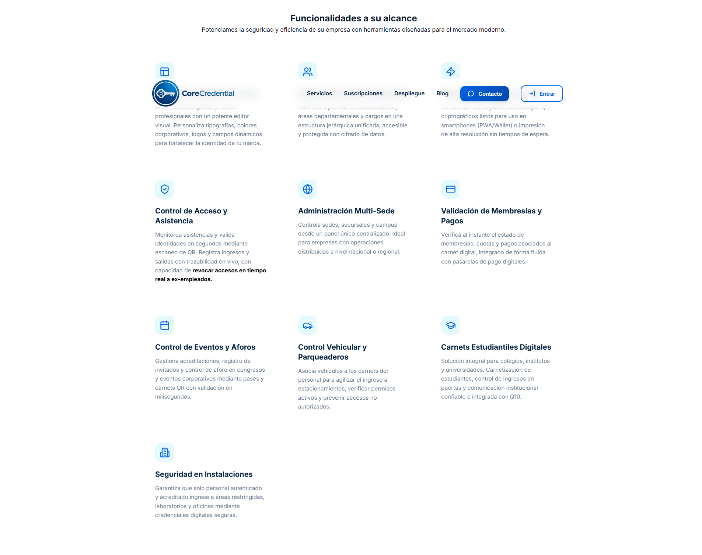

### 3. Consulta de planes y tarifas comerciales
1. Dirígete a la sección **Suscripciones** mediante el menú superior.
2. Alterna entre facturación mensual o anual con descuento especial.
3. Elige el plan que mejor se adapte al volumen de colaboradores de tu organización.

*Figura 3. Selector de planes y tarifas de suscripción.*

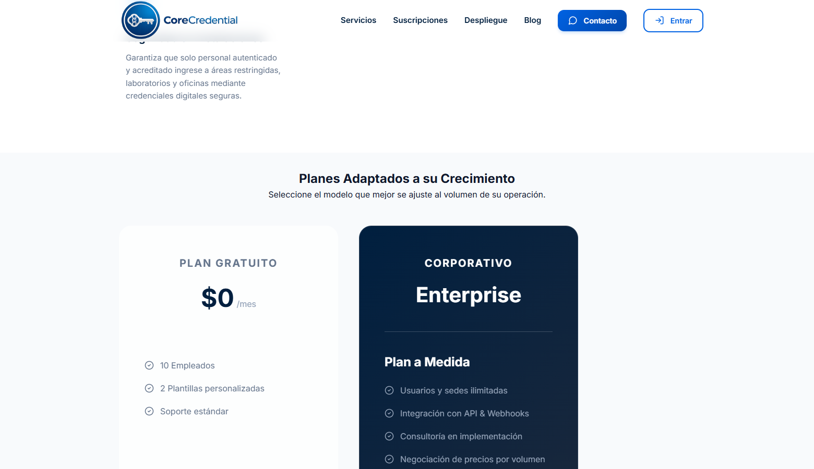

### 4. Opciones de arquitectura e infraestructura
1. Revisa las modalidades de hospedaje técnico.
2. Compara la solución Cloud SaaS gestionada frente al despliegue On-Premises en los servidores privados de tu institución.

*Figura 4. Comparativa de arquitectura Cloud SaaS frente a On-Premises.*

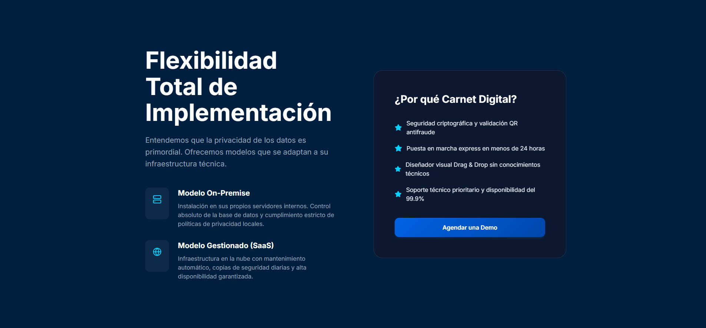

### 5. Contacto comercial y pie de página
1. Utiliza los canales directos del pie de página para resolver inquietudes técnicas o comerciales.
2. Consulta las políticas de tratamiento de datos y términos de servicio institucional.

*Figura 5. Sección de llamado a la acción y enlaces institucionales.*

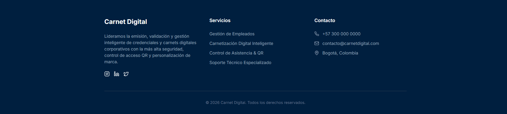

### 6. Portal de novedades y artículos técnicos
1. Haz clic en la opción **Blog** de la barra superior.
2. Filtra por categorías como *Seguridad*, *Innovación* o *Gestión* para consultar artículos de interés.

*Figura 6. Directorio de publicaciones y artículos del blog institucional.*

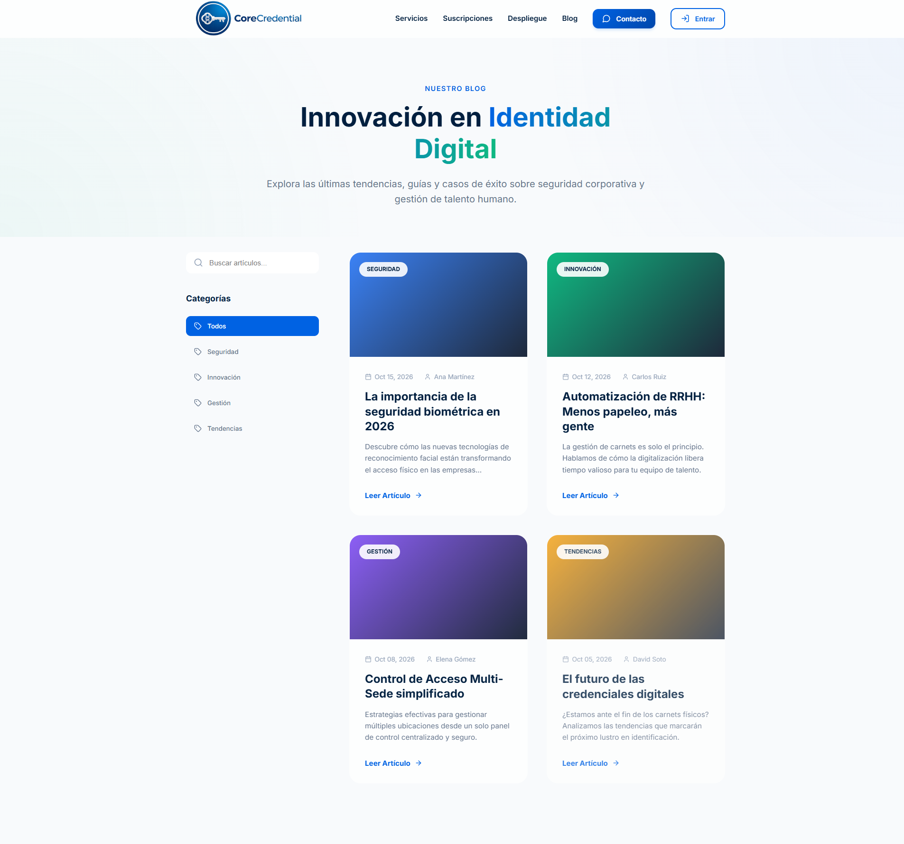

### 7. Inicio de sesión en la plataforma
1. Haz clic en el botón **Entrar** ubicado en la esquina superior derecha.
2. Escribe tu correo electrónico corporativo registrado.
3. Escribe tu contraseña de acceso asignada.
4. Haz clic en el botón **Iniciar Sesión**.

*Figura 7. Ventana de autenticación e inicio de sesión seguro.*

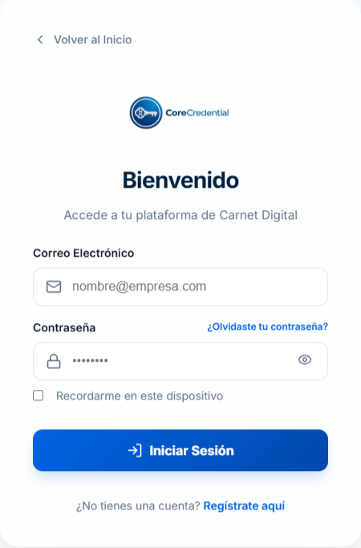

> [!NOTE]
> Si la plataforma se encuentra en ventana de mantenimiento técnico, el sistema mostrará un aviso informativo antes de permitir el ingreso.

### 8. Registro de una nueva empresa cliente
1. En la tarjeta de acceso, haz clic en el enlace **¿No tienes cuenta? Regístrate aquí**.
2. Diligencia la razón social completa de tu empresa y el número de identificación tributaria (NIT).
3. Escribe los datos de contacto del administrador y define una contraseña segura.

*Figura 8. Formulario inicial para dar de alta una nueva organización.*

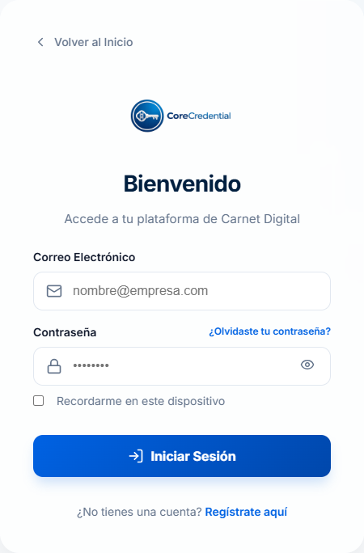

### 9. Confirmación de suscripción exitosa
1. Al finalizar el pago en la pasarela, el sistema mostrará la pantalla de confirmación exitosa con tu identificador de transacción.
2. Haz clic en **Ir al Login** para iniciar sesión y acceder inmediatamente al panel corporativo.

*Figura 9. Comprobante oficial de pago aprobado y activación de cuenta.*

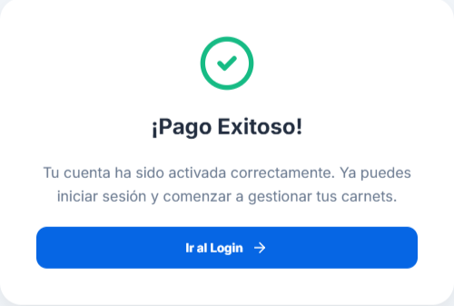

---

## Módulo 2. Consola SuperAdmin de plataforma

### 10. Tablero de control y métricas globales
1. Revisa los indicadores clave de desempeño: Empresas activas, ingresos mensuales recurrentes (MRR) y total de carnets emitidos.
2. Examina la gráfica de crecimiento intermensual y el registro de eventos recientes.

*Figura 10. Tablero de control principal de la plataforma central.*

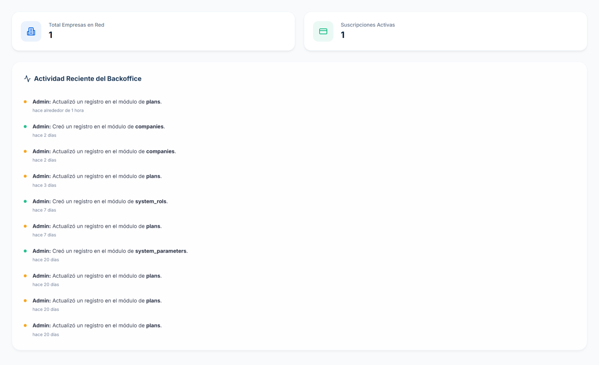

### 11. Directorio de empresas suscritas
1. Haz clic en la opción **Empresas** del menú lateral izquierdo.
2. Consulta el listado de empresas con su plan activo, fecha de expiración y estado operativo.
3. Utiliza la barra de búsqueda para ubicar rápidamente una empresa por su nombre o NIT.

*Figura 11. Directorio maestro y buscador de empresas suscritas.*

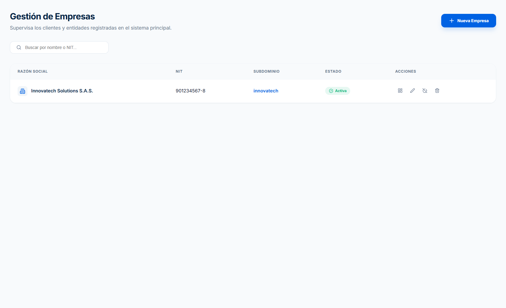

### 12. Registro manual de una nueva empresa
1. Haz clic en el botón superior **+ Nueva Empresa**.
2. Completa los campos: Razón social, NIT, correo del administrador y teléfono.
3. Selecciona el plan comercial inicial contratado.
4. Haz clic en **Guardar Empresa** para crear el inquilino (tenant) en la base de datos.

*Figura 12. Ventana modal para registrar manualmente una organización.*

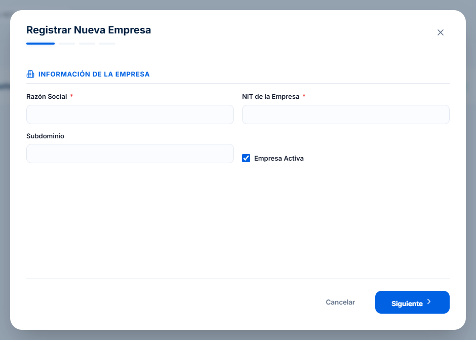

### 13. Catálogo de planes comerciales
1. Haz clic en **Planes** en el menú lateral.
2. Visualiza las tarifas vigentes, el límite de colaboradores y el número máximo de plantillas autorizadas.

*Figura 13. Directorio de planes y condiciones comerciales del sistema.*

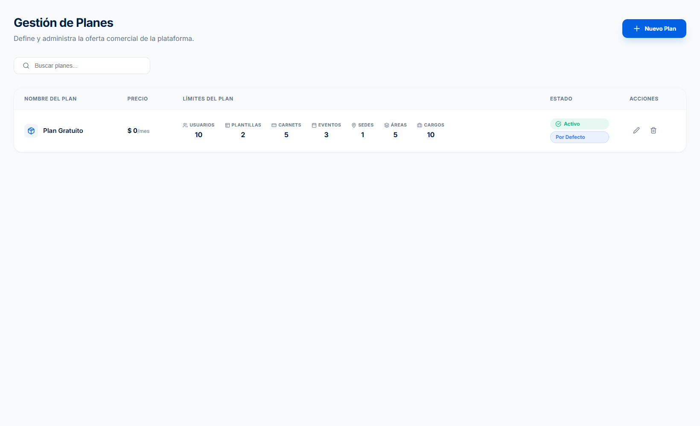

### 14. Creación y edición de condiciones de plan
1. Haz clic en el botón **+ Nuevo Plan**.
2. Define el nombre del plan (ejemplo: *Enterprise Pro*), precio mensual y precio anual.
3. Especifica el límite estricto de colaboradores y de plantillas.
4. Haz clic en **Crear Plan**.

*Figura 14. Modal para parametrizar costos y cuotas de un plan.*

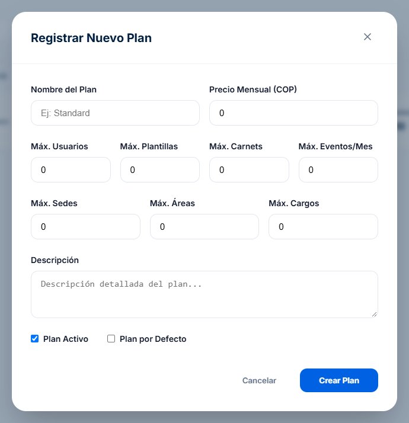

### 15. Auditoría de suscripciones y transacciones
1. Ingresa a la sección **Suscripciones**.
2. Supervisa las renovaciones automáticas, estados de cuenta (al día, vencido) y facturas generadas.

*Figura 15. Monitor de facturación y transacciones de suscripción.*

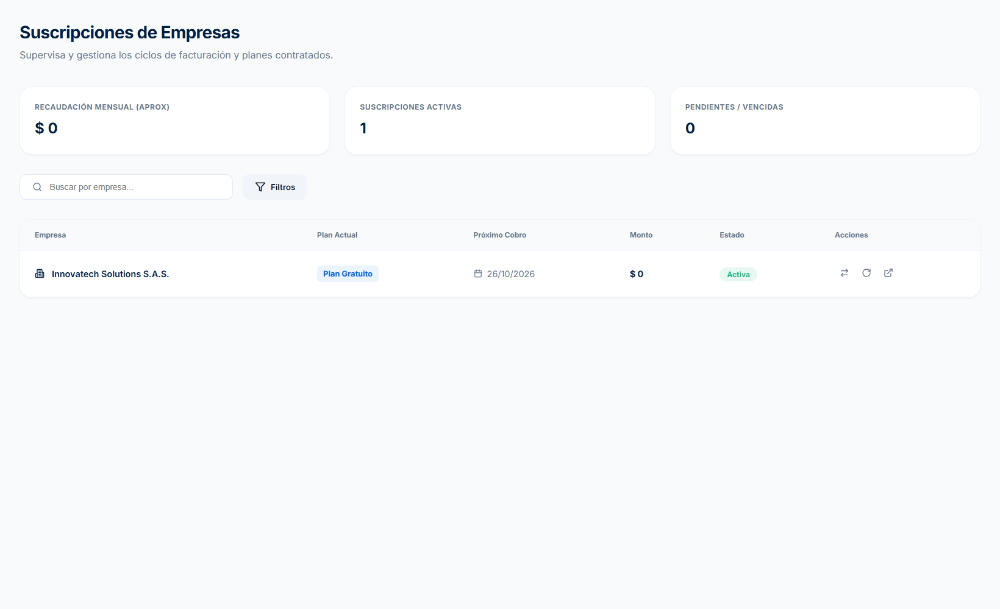

### 16. Administración de operadores del sistema
1. Haz clic en **Usuarios** dentro de la consola del sistema.
2. Observa la nómina de operadores con privilegios de superadministrador.

*Figura 16. Listado de operadores y técnicos del núcleo central.*

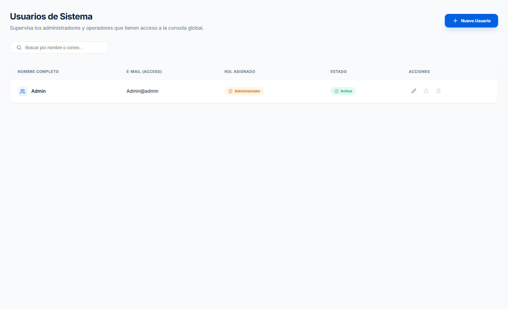

### 17. Alta de operador del sistema
1. Haz clic en **+ Nuevo Usuario**.
2. Escribe los nombres, correo institucional y contraseña temporal.
3. Asigna el rol correspondiente (ejemplo: *Administrador* o *Soporte*).
4. Haz clic en **Guardar Usuario**.

*Figura 17. Ventana para crear cuentas de operadores técnicos.*

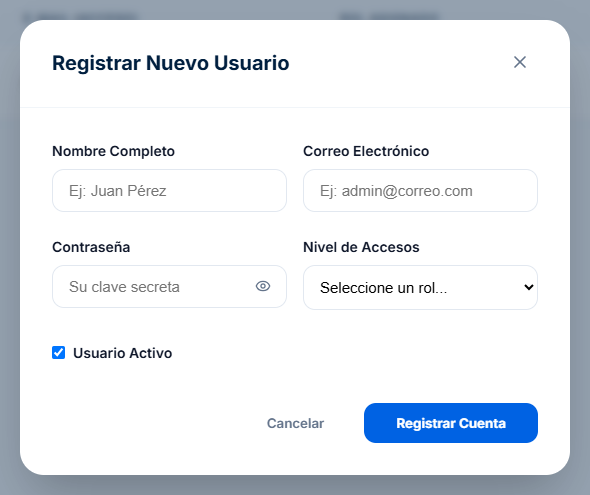

### 18. Matriz de roles y privilegios
1. Ingresa a la opción **Roles**.
2. Consulta las definiciones de perfiles del sistema y su alcance de gestión.

*Figura 18. Matriz de privilegios y perfiles de usuario del sistema.*

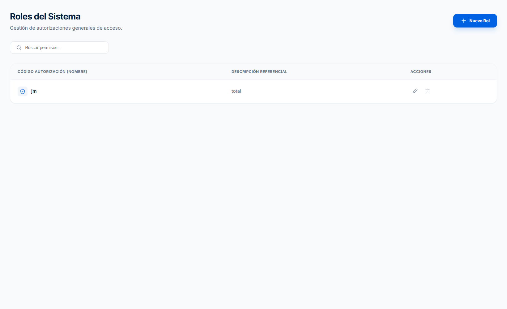

### 19. Creación de un nuevo rol de sistema
1. Haz clic en **+ Nuevo Rol**.
2. Ingresa el identificador único y una descripción de responsabilidades.
3. Guarda la configuración para aplicarla de inmediato a los operadores.

*Figura 19. Formulario modal para registrar un nuevo rol administrativo.*

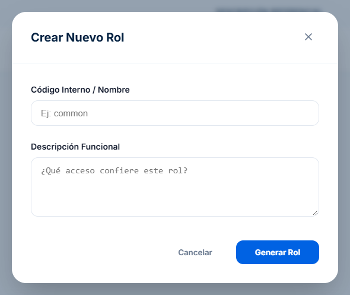

### 20. Parámetros globales y banners institucionales
1. Haz clic en **Parámetros** en el menú lateral.
2. Activa o desactiva el switch de **Permitir Inicio de Sesión** para labores de mantenimiento.
3. Carga nuevas imágenes de banner y verifica su previsualización en tiempo real.

*Figura 20. Panel de control de modo mantenimiento y banners informativos.*

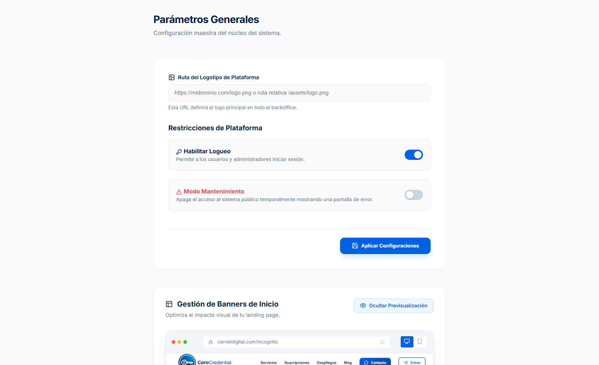

---

## Módulo 3. Panel corporativo de la empresa cliente

### 21. Tablero principal de la empresa
1. Accede con tus credenciales de empresa.
2. Observa el saludo institucional, el resumen de colaboradores activos y la distribución por sedes.
3. Verifica la barra de progreso de cupos de carnets disponibles.

*Figura 21. Tablero de control corporativo de la organización.*

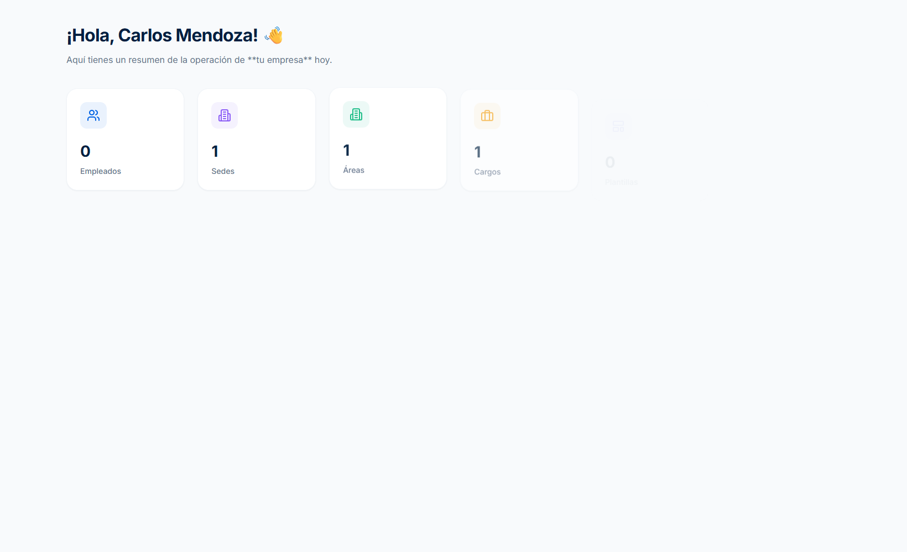

### 22. Gestión de sedes y sucursales físicas
1. Haz clic en la opción **Sedes** del menú corporativo.
2. Consulta las instalaciones físicas registradas (oficinas principales, plantas o sucursales).

*Figura 22. Directorio maestro de sedes físicas registradas.*

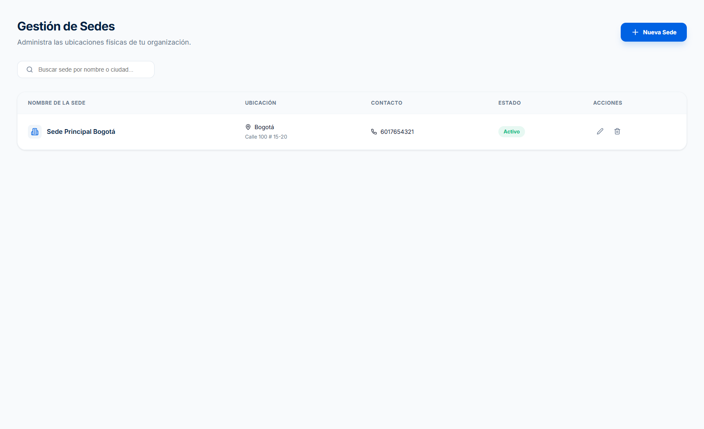

### 23. Registro de una nueva sede
1. Haz clic en el botón **+ Nueva Sede**.
2. Escribe el nombre de la sede (ejemplo: *Sede Principal Calle 100*), ciudad y dirección exacta.
3. Haz clic en **Guardar Sede**.

*Figura 23. Modal de ingreso de datos de una sede física.*

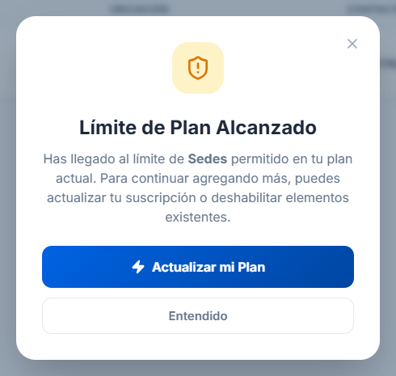

### 24. Estructura de áreas y departamentos
1. Dirígete a la opción **Áreas**.
2. Examina los departamentos funcionales (Tecnología, Operaciones, Ventas) adscritos a cada sede.

*Figura 24. Estructura departamental y áreas de trabajo de la empresa.*

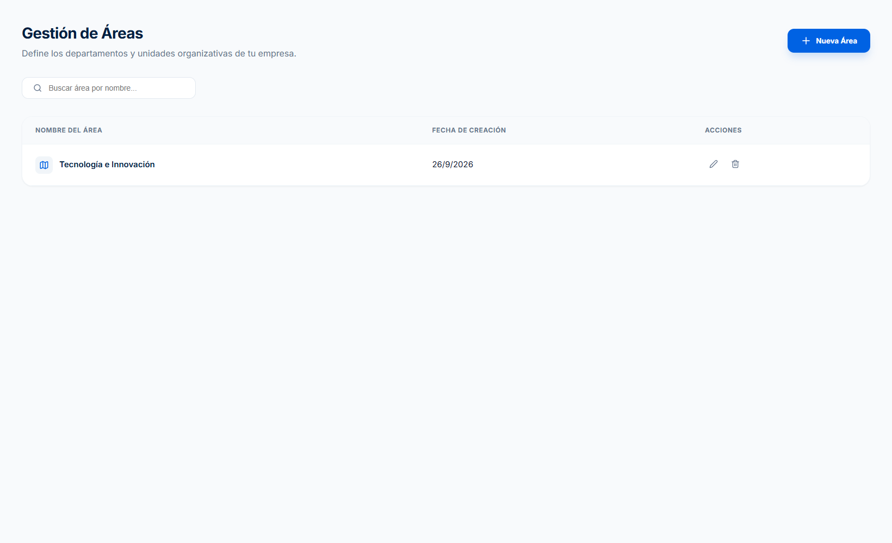

### 25. Creación de un área o departamento
1. Haz clic en **+ Nueva Área**.
2. Escribe la denominación del área.
3. Selecciona en el menú desplegable la sede física a la cual pertenece.
4. Haz clic en **Guardar Área**.

*Figura 25. Formulario modal para crear y asociar un área.*

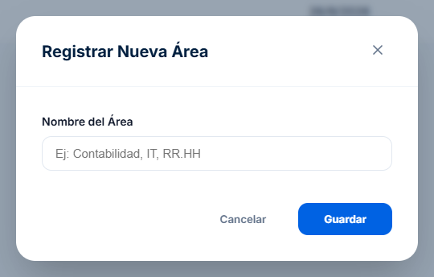

### 26. Catálogo de cargos y puestos de trabajo
1. Haz clic en **Cargos** en el menú lateral.
2. Consulta el listado de cargos laborales organizados por área funcional.

*Figura 26. Catálogo de cargos laborales activos en la organización.*

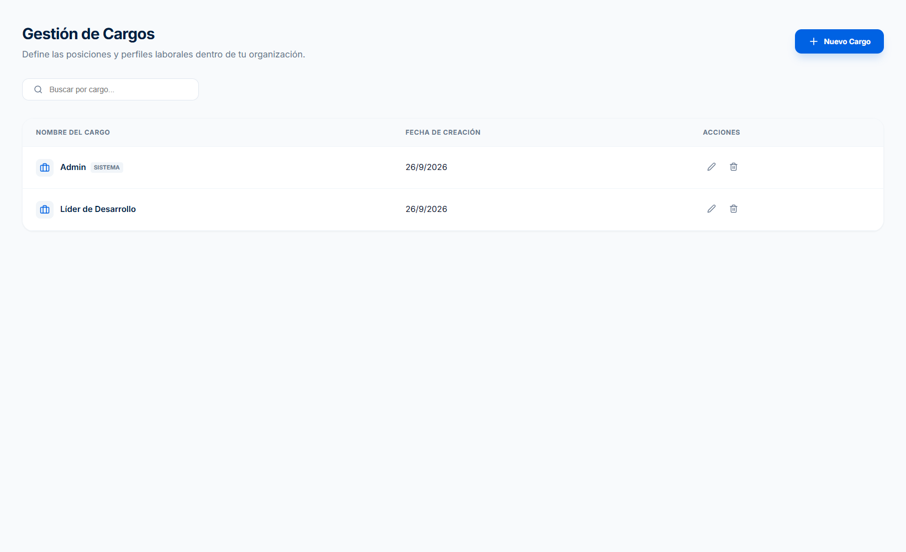

### 27. Alta de un nuevo cargo
1. Haz clic en **+ Nuevo Cargo**.
2. Ingresa el título del puesto (ejemplo: *Ingeniero de Software Senior*).
3. Selecciona el área a la que pertenece.
4. Haz clic en **Guardar Cargo**.

*Figura 27. Ventana modal para registrar un cargo laboral.*

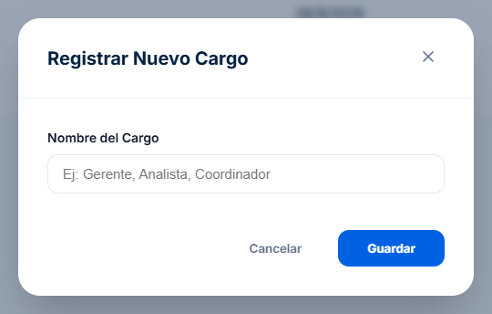

### 28. Directorio maestro de colaboradores
1. Haz clic en la opción **Colaboradores**.
2. Visualiza a todo el personal con su fotografía, documento de identidad, cargo, sede y estado de carnetización.
3. Utiliza los filtros superiores para segmentar por área o cargo.

*Figura 28. Directorio general de colaboradores con opciones de búsqueda.*

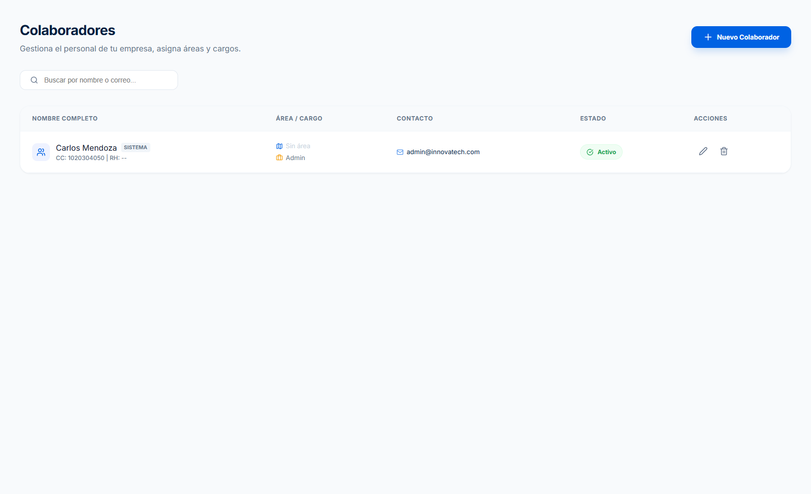

### 29. Registro completo de un colaborador
1. Haz clic en el botón superior **+ Nuevo Colaborador**.
2. Selecciona el tipo de documento (Cédula de Ciudadanía, Pasaporte o Cédula de Extranjería) e ingresa el número.
3. Escribe los nombres, apellidos, correo corporativo y número de celular.
4. Asigna la sede, área y cargo correspondientes.
5. Carga la fotografía formal del colaborador en formato JPG o PNG.
6. Haz clic en **Guardar Colaborador**.

*Figura 29. Formulario modal integral para el registro de colaboradores.*

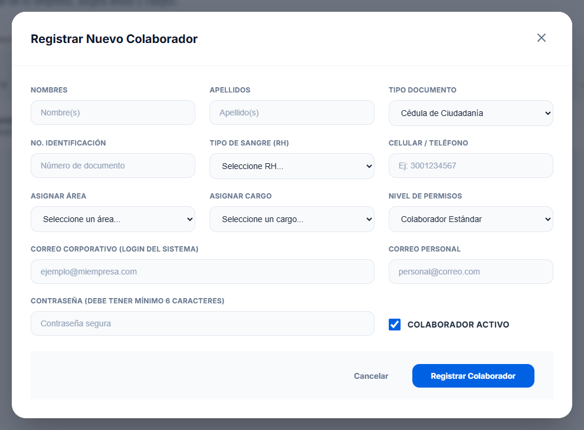

### 30. Galería de plantillas de credenciales
1. Haz clic en **Plantillas** en el menú corporativo.
2. Revisa los diseños creados para personal de planta, contratistas, directivos o eventos especiales.

*Figura 30. Galería de plantillas visuales de carnetización.*

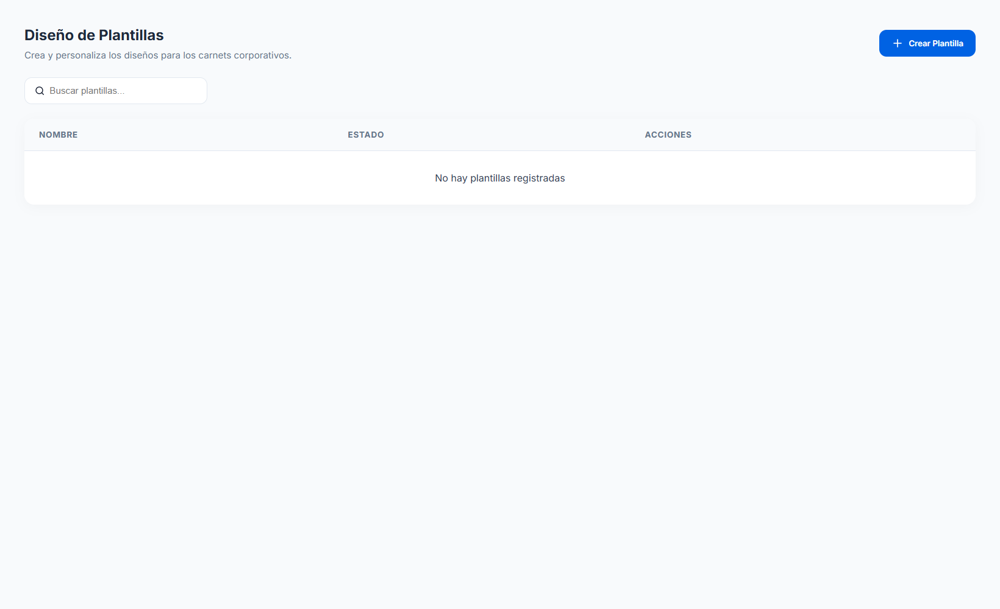

### 31. Diseñador interactivo de plantillas de carnet
1. Haz clic en **+ Nueva Plantilla** o selecciona una existente para editarla.
2. Sube la imagen de fondo institucional de tu organización.
3. Arrastra y ubica las capas de texto dinámico: `{{nombres}}`, `{{apellidos}}`, `{{cargo}}` y `{{sede}}`.
4. Ajusta la posición y tamaño del recuadro para el código QR y la fotografía.
5. Haz clic en **Guardar Plantilla** para habilitarla en las emisiones.

*Figura 31. Editor gráfico interactivo Canvas para diseñar credenciales.*

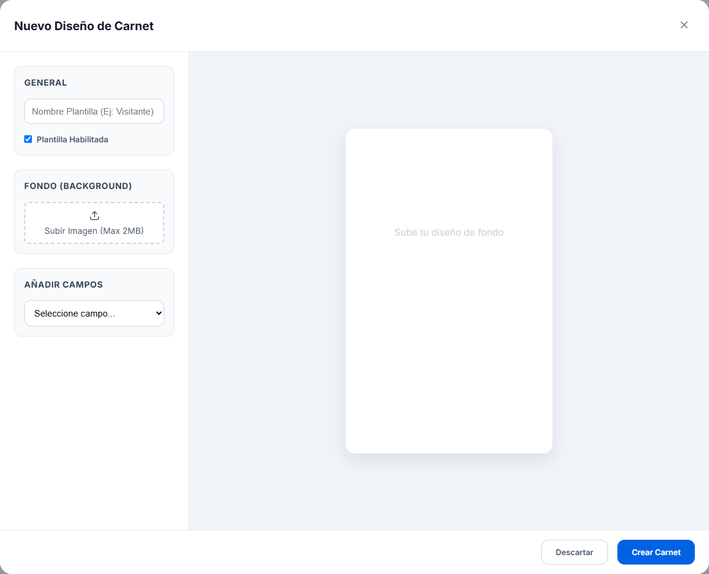

### 32. Control de emisión y descarga de carnets
1. Haz clic en la opción **Carnetización**.
2. Consulta los carnets emitidos, vigencias y fechas de expedición.
3. Haz clic en el ícono de descarga para obtener la credencial en PDF de alta resolución.
4. En caso de retiro del funcionario o pérdida del carnet, utiliza la opción **Revocar**.

*Figura 32. Listado de carnets emitidos con opciones de descarga y revocación.*

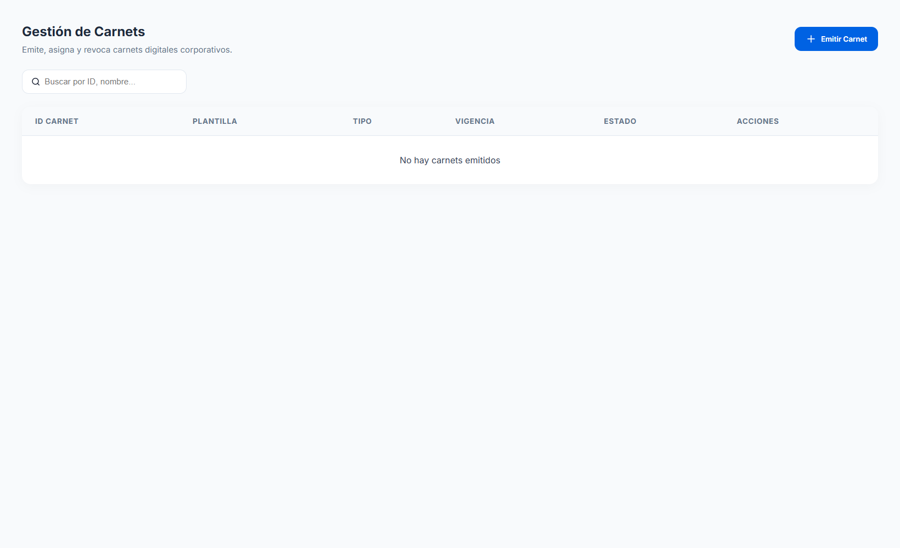

> [!WARNING]
> La revocación de una credencial invalida de inmediato el código QR ante cualquier lector de control de acceso físico.

### 33. Emisión individual de credencial
1. Haz clic en el botón **+ Emitir Carnet**.
2. Elige el colaborador en el selector desplegable.
3. Elige la plantilla visual aprobada.
4. Fija la fecha de expiración del carnet.
5. Haz clic en **Emitir Credencial**.

*Figura 33. Modal de emisión individual y generación de código QR.*

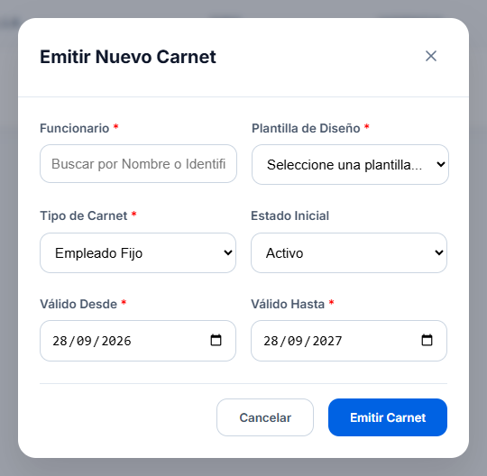

> [!ALERT]
> Si la cuota de carnets contratados se encuentra agotada, el sistema bloqueará la emisión y te solicitará contactar a tu asesor para recargar cupos.

### 34. Configuración de marca corporativa (*White-Labeling*)
1. Ingresa a la opción **Configuración de Marca**.
2. Personaliza el color primario y secundario con el selector de color o código hexadecimal.
3. Elige la tipografía institucional preferida.
4. Carga el archivo del logotipo oficial de tu empresa.
5. Haz clic en **Guardar Cambios** para aplicar la identidad visual en todo tu entorno.

*Figura 34. Módulo de configuración de marca, colores y logotipo de empresa.*

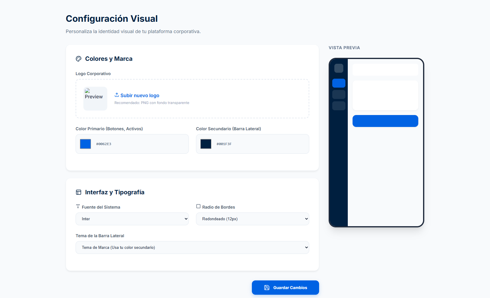

### 35. Consulta de plan, cuotas y recarga de cupos
1. Haz clic en la opción **Suscripción**.
2. Verifica el plan vigente, costo y fecha de renovación programada.
3. Consulta la barra de consumo de carnets emitidos sobre el límite total permitido.
4. Haz clic en **Actualizar Plan / Recargar Cupos** si requieres emitir credenciales adicionales.

*Figura 35. Panel de control del plan contratado y consumo de cupos.*

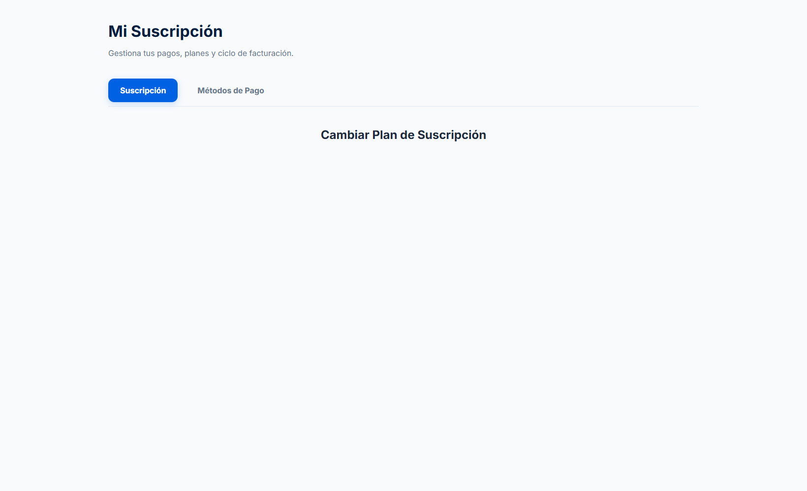

---

## Anexo. Preguntas frecuentes y solución de problemas

| Situación o duda frecuente | Causa probable | Solución recomendada paso a paso |
| :--- | :--- | :--- |
| **El botón 'Emitir Carnet' se encuentra inhabilitado** | La empresa ha alcanzado el límite máximo de carnets contratados en su plan. | Ingresa al módulo **Suscripción** y selecciona la opción de recarga de cupos o cambio a un plan superior. |
| **Al escanear el carnet con el teléfono, se indica credencial inválida** | El carnet ha superado su fecha de expiración o fue revocado por el administrador. | Verifica el estado en el módulo **Carnetización**. Si está revocado, emite una nueva credencial con fecha vigente. |
| **Error HTTP 401 al invocar endpoints de API** | El token JWT ha expirado o la cabecera Authorization está ausente. | Inicia sesión nuevamente para renovar el token en localStorage o genera uno nuevo con la clave JWT_SECRET. |
| **No se visualizan las sedes al crear un área** | No existen sedes creadas previamente en la organización. | Ingresa primero al módulo **Sedes**, registra al menos una sucursal física y posteriormente asocia el área. |
| **El logotipo no se visualiza correctamente en el carnet** | El formato o las dimensiones de la imagen cargada no son transparentes o superan el tamaño sugerido. | Sube el logotipo en formato PNG con fondo transparente y resolución de 500x500 píxeles desde el módulo **Configuración de Marca**. |
