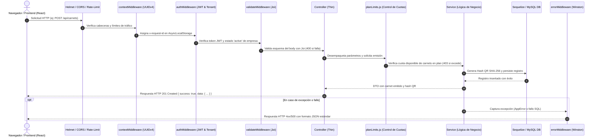
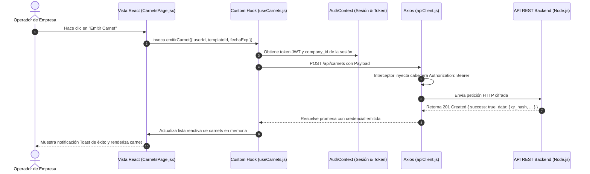

# DIRECCIÓN TIC
## Manual Técnico de Arquitectura de Software (Frontend & Backend)
### Aplicativo Carnet Digital (Versión 2026)

---

## Control de versiones

| Fecha | Versión | Autor / Elaboró | Revisó | Modificación | Aprobación |
| :--- | :---: | :--- | :--- | :--- | :--- |
| **28/09/2026** | **2.5.0** | Ing. Especialista TIC<br>Arquitectura Full Stack | Dirección de Planeación y TIC | Documento oficial de arquitectura técnica: Backend Node.js/Express, Frontend React 19/Canvas, API Reference y ADRs. | Dirección TIC /<br>Rectoría General |

### Firmas de responsabilidad institucional

| Elaboró / Modificó | Revisó | Aprobó |
| :--- | :--- | :--- |
| **Ing. Especialista TIC**<br>Líder de Desarrollo y Arquitectura<br>Dirección TIC<br>*Fecha: 28 de septiembre de 2026* | **Directora de Planeación y TIC**<br>Dirección de Planeación y Calidad (E)<br>Institución / Organización<br>*Fecha: 28 de septiembre de 2026* | **Dirección General / Rectoría**<br>Dirección Ejecutiva Institucional<br>Institución / Organización<br>*Fecha: 28 de septiembre de 2026* |

---

## Introducción a la arquitectura

El aplicativo de Gestión y Emisión de Carnets Digitales (**Carnet Digital**) es un sistema modular de nivel empresarial diseñado para la emisión, validación criptográfica y administración del ciclo de vida de credenciales digitales.

Este manual técnico expone la arquitectura integral del sistema, estructurado bajo el estándar internacional **arc42 (ISO/IEC/IEEE 42010)** y las pautas de estilo de la **Guía de Estilo de Escritura de Microsoft**. Detalla el desacoplamiento de capas, los patrones de diseño aplicados, el ciclo de vida de peticiones HTTP, el catálogo completo de 24 endpoints REST, el motor gráfico de credenciales a 300 DPI y los Registros de Decisiones de Arquitectura (ADR).

---

## Mapa de arquitectura del sistema

`mermaid
graph TD
    Client[Cliente SPA: React 19 / Vite]
    CDN[Nginx Reverse Proxy / SSL Let's Encrypt]
    API[API REST Backend: Node.js 20 LTS / Express 5]
    MySQL[(Base de Datos MySQL / Sequelize ORM)]
    Cache[(Caché en Memoria / node-cache)]
    MP[Pasarela de Pago: Mercado Pago SDK]
    Files[Almacenamiento Local: src/uploads/]

    Client -->|HTTPS / RESTful JSON / Bearer JWT| CDN
    CDN -->|Proxy Pass localhost:4000| API
    API -->|Pool de Conexiones / Transacciones ACID| MySQL
    API -->|Caché de Planes y Configuración| Cache
    API -->|Creación de Preferencias y Webhooks HMAC| MP
    API -->|Multer: Logos y Banners| Files
`

---

# Parte 1. Arquitectura técnica del backend

### 1.1 Stack tecnológico y especificaciones del entorno

El backend de **Carnet Digital** opera como un servicio RESTful en Node.js, optimizado para procesar solicitudes asíncronas no bloqueantes con baja latencia y alta concurrencia:

| Capa del servidor | Librería y versión | Rol y responsabilidad técnica |
| :--- | :--- | :--- |
| **Motor de ejecución** | Node.js v20+ LTS | Entorno de ejecución asíncrono basado en eventos sobre el motor V8 de Google. |
| **Framework web** | Express v5.x | Enrutamiento modular, gestión de middleware y resolución nativa de promesas sin `try/catch` redundantes. |
| **Persistencia relacional** | Sequelize v6.x / mysql2 | Mapeo objeto-relacional (ORM), transacciones ACID, integridad referencial e índices compuestos. |
| **Criptografía y JWT** | jsonwebtoken v9.x / bcryptjs v3.x | Firma digital de tokens de sesión con expiración y hashing unidireccional de claves (*costo = 10*). |
| **Validación de esquemas** | Joi v18.x | Sanitización estricta de entradas y payloads JSON antes de alcanzar los controladores. |
| **Manejo de archivos** | Multer v2.x | Recepción y almacenamiento local de fotografías de colaboradores y logotipos institucionales. |
| **Pasarela de pagos** | Mercado Pago SDK v2.x | Creación de preferencias de suscripción, checkout pro y verificación de firmas HMAC en webhooks. |
| **Seguridad perimetral** | Helmet, CORS, Express-Rate-Limit | Protección contra XSS, MIME-sniffing, Clickjacking y ataques de fuerza bruta o denegación de servicio. |
| **Compresión de datos** | Compression v1.x | Compresión automática Gzip y Deflate de cargas JSON salientes para reducir latencia de red. |
| **Caché en memoria** | node-cache v5.x | Capa de caché en RAM para parámetros de sistema y validaciones públicas de carnets. |
| **Auditoría y logs** | Winston v3.x / Morgan v1.x | Registro estructurado en formato JSON con rotación diaria y correlación por Request-ID. |
| **Planificador de tareas** | node-cron v4.x | Automatización nocturna de vencimiento de suscripciones y transiciones de estado a las 00:05 AM. |

---

### 1.2 Topología general de carpetas y arquitectura en capas

El código fuente del backend, ubicado en `src/`, implementa una arquitectura en capas estrictamente desacoplada (*Separation of Concerns*). Cada directorio asume una responsabilidad única dentro del ciclo de vida de la aplicación:

```text
src/
├── config/             # Configuración de base de datos MySQL, pooling y variables de entorno
├── middleware/         # Seguridad perimetral, verificación JWT, validación Joi y captura de errores
├── routes/             # Enrutamiento modular RESTful y montaje de prefijos de API
├── controllers/        # Controladores delgados: recepción HTTP, extracción de datos y respuestas
├── services/           # Lógica de negocio pura, transacciones ACID y orquestación externa
├── models/             # Esquemas Sequelize agrupados en core, tenant y raíz
├── validators/         # Esquemas declarativos de validación y sanitización con Joi
├── utils/              # Motor de límites (planLimits), contexto ALS, logging y caché
├── helpers/            # Seeder automático de inicio y envoltorios asíncronos
├── jobs/ & workers/    # Tareas programadas con node-cron y trabajadores de segundo plano
├── uploads/            # Almacenamiento local particionado para logos institucionales y banners
├── app.js              # Configuración y montaje de middlewares globales de Express
└── server.js           # Inicialización HTTP, conexión a base de datos y tareas de arranque
```

| Carpeta en `src/` | Responsabilidad arquitectónica | Patrón de diseño aplicado | Archivos y módulos destacados |
| :--- | :--- | :--- | :--- |
| **`src/config/`** | Centraliza la configuración de infraestructura y conexiones externas. | Singleton / Factory Pool | `database.js` |
| **`src/middleware/`** | Interceptores de solicitudes HTTP para seguridad, contexto, carga de archivos y errores. | Chain of Responsibility / Pipeline | `authMiddleware.js`, `contextMiddleware.js`, `validateMiddleware.js`, `uploadMiddleware.js`, `errorMiddleware.js` |
| **`src/routes/`** | Define las rutas del protocolo REST y vincula los middlewares a los controladores. | Front Controller / Router Module | `index.js`, `authRoutes.js`, `companyRoutes.js`, `companyCarnetRoutes.js`, `companyUserRoutes.js` |
| **`src/controllers/`** | Adaptadores HTTP que transforman peticiones en llamadas a servicios y emiten respuestas JSON. | Thin Controller / Adapter | `authUnifiedController.js`, `companyCarnetController.js`, `companyUserController.js`, `webhookController.js` |
| **`src/services/`** | Núcleo de la plataforma: implementa reglas de negocio, transacciones e integraciones. | Service Layer / Domain Facade | `authService.js`, `companyCarnetService.js`, `mercadopagoService.js`, `companyUserService.js` |
| **`src/models/`** | Definición de tablas, tipos de datos, índices y asociaciones relacionales en MySQL. | Active Record / Data Mapper (Sequelize) | `models/core/`, `models/tenant/`, `models/index.js` |
| **`src/validators/`** | Reglas estrictas de validación de campos, tipos, longitudes y expresiones regulares. | Validator / Specification | `authValidator.js`, `companyValidator.js`, `carnetValidator.js`, `planValidator.js` |
| **`src/utils/`** | Módulos transversales de soporte técnico, observabilidad y control de consumo. | Utility / Cross-Cutting Concerns | `planLimits.js`, `context.js`, `logger.js`, `cache.js`, `appError.js` |
| **`src/helpers/`** | Funciones auxiliares de arranque, siembra de datos iniciales y wrappers. | Helper / Seeder | `initializeSystemData.js`, `asyncHandler.js` |
| **`src/jobs/` y `workers/`** | Procesos en segundo plano y automatización de cronogramas nocturnos. | Task Scheduler / Background Worker | `subscriptionExpiryJob.js`, `billingWorker.js` |
| **`src/uploads/`** | Directorio físico para la persistencia local de imágenes multi-inquilino. | Static Asset Repository | `uploads/logos/`, `uploads/banners/` |

---

### 1.3 Explicación exhaustiva carpeta por carpeta

#### 1.3.1 Carpeta `src/config/` (Configuración de base de datos y entorno)

Esta carpeta gestiona la conexión con el servidor MySQL y la inicialización de librerías base.

- **`database.js`:**
  - Instancia el objeto `Sequelize` utilizando el dialecto `mysql`.
  - Configura un pool de conexiones administrado:
    - `max: 10`: Permite un máximo de 10 conexiones simultáneas por proceso para evitar saturación del motor SQL.
    - `min: 0`: Cierra conexiones ociosas cuando no hay tráfico.
    - `idle: 10000`: Tiempo máximo (10 segundos) que una conexión puede permanecer inactiva antes de ser liberada.
    - `acquire: 30000`: Tiempo máximo (30 segundos) de espera para adquirir una conexión antes de lanzar error por timeout.
  - Sincronización horaria: Aplica `timezone: '-05:00'` en la conexión a MySQL y fija `process.env.TZ = 'America/Bogota'`, asegurando que las fechas de emisión, vencimiento y bitácora no sufran desfases.
  - Control de logging: En entorno de producción (`NODE_ENV === 'production'`) silencia las consultas SQL por consola (`logging: false`), mientras que en desarrollo envía las consultas al logger central Winston.

- **Variables de entorno (`.env`):**
  Centraliza parámetros críticos que varían entre desarrollo y producción:

| Variable de entorno | Tipo | Ejemplo / Predeterminado | Impacto en la arquitectura |
| :--- | :--- | :--- | :--- |
| `PORT` | Number | `4000` | Puerto TCP en el que escucha el servidor Express (Fallback: 3010). |
| `NODE_ENV` | String | `development / production` | Controla la verbosidad de logs, formateo de trazas y optimización de cachés. |
| `DB_HOST` | String | `localhost` | Dirección de red del servidor MySQL. |
| `DB_USER` | String | `root` | Cuenta de usuario de MySQL con permisos DDL y DML. |
| `DB_PASSWORD` | String | `********` | Credencial secreta de autenticación en la base de datos. |
| `DB_NAME` | String | `CoreCredencial / carnet_digital` | Nombre de la base de datos relacional. |
| `DB_TIMEZONE` | String | `-05:00` | Offset horario para las sesiones de MySQL. |
| `JWT_SECRET` | String | Clave hexadecimal 32+ chars | Semilla criptográfica utilizada para firmar y verificar tokens de sesión. |
| `JWT_EXPIRES_IN` | String | `1h` | Tiempo de vida del token de acceso (Access Token). |
| `ADMIN_DEFAULT_EMAIL` | String | `Admin@admin` | Correo del SuperAdmin inicial sembrado automáticamente. |
| `FREE_PLAN_MAX_USERS` | Integer | `10` | Cantidad máxima de colaboradores permitidos en el plan inicial sin costo. |
| `MERCADOPAGO_TEST_ACCESS_TOKEN` | String | `APP_USR-...` | Token de acceso a la API REST de Mercado Pago en Sandbox. |
| `MERCADOPAGO_PROD_ACCESS_TOKEN` | String | `APP_USR-...` | Token de acceso en producción para procesamiento real de cobros. |
| `BACKEND_URL` | String | `http://localhost:4000` | URL pública del backend para la configuración del Webhook de Mercado Pago. |
| `MERCADOPAGO_BACK_URL` | String | `http://localhost:5173/payment-success` | URL de retorno al frontend al completar la pasarela de pago. |

---

#### 1.3.2 Carpeta `src/middleware/` (Seguridad perimetral, contexto y validación)

Los middlewares constituyen la cadena de interceptores que validan, enriquecen y protegen cada petición HTTP antes de que alcance los controladores de negocio:

1. **`contextMiddleware.js` (Contexto de petición y trazabilidad):**
   - Utiliza `AsyncLocalStorage` nativo de Node.js para crear un contexto aislado por solicitud.
   - Lee la cabecera entrante `x-request-id` o genera un identificador único mediante `uuid.v4()`.
   - Inyecta dicho ID en la cabecera de respuesta `x-request-id` y en el almacén asíncrono, permitiendo que cualquier función interna de log registre este ID sin necesidad de pasarlo como parámetro en cascada.

2. **`authMiddleware.js` (Autenticación y autorización RBAC multi-inquilino):**
   - **Extracción:** Intercepta la cabecera `Authorization: Bearer <token>`. Si no existe o tiene formato erróneo, retorna inmediatamente `401 Unauthorized`.
   - **Verificación criptográfica:** Valida la firma del token contra `JWT_SECRET` y comprueba que no haya expirado.
   - **Inyección de usuario:** Asigna a `req.user` la carga útil decodificada (`id`, `email`, `role`, `company_id`, `type`).
   - **Aislamiento Multi-Tenant:** Si el token es de tipo `company`, verifica en base de datos que la empresa se encuentre en estado `active`. Si la empresa está suspendida o inactiva por mora en suscripción, bloquea el acceso con código `403 Forbidden` y mensaje `"Su empresa se encuentra suspendida o inactiva"`.
   - **Guardias de Rol (RBAC):** Expone funciones middleware como `requireSuperAdmin` y `requireCompanyAdmin`, que comparan los privilegios requeridos contra el rol asignado en la sesión.

3. **`validateMiddleware.js` (Validación de esquemas con Joi):**
   - Recibe como parámetro un esquema declarativo de Joi y el segmento a evaluar (`body`, `query` o `params`).
   - Aplica `abortEarly: false` para recopilar la totalidad de inconsistencias en una sola pasada.
   - Si la validación falla, interrumpe el ciclo y responde con código `400 Bad Request`, devolviendo una lista detallada con los nombres de campos y mensajes amigables.
   - Si es exitoso, reemplaza el cuerpo de la petición con los datos ya sanitizados (eliminando propiedades desconocidas no declaradas en el esquema).

4. **`uploadMiddleware.js` y `bannerUploadMiddleware.js` (Recepción de archivos):**
   - Configura `multer.diskStorage` definiendo como destino las carpetas `src/uploads/logos/`, `src/uploads/banners/` o temporales.
   - Genera nombres de archivo seguros y no colisionantes mediante marcas de tiempo y cadenas pseudo-aleatorias (`file-${Date.now()}-${Math.round(Math.random() * 1e9)}${ext}`).
   - `fileFilter`: Restringe la carga exclusivamente a formatos de imagen autorizados (`image/jpeg`, `image/png`, `image/webp`). Cualquier otro archivo es rechazado de inmediato.
   - Aplica límite de tamaño estricto de **5 MB** por archivo.

5. **`errorMiddleware.js` (Capturador global de errores):**
   - Middleware de cuatro parámetros `(err, req, res, next)` ubicado al final de la cadena en `app.js`.
   - Clasifica los errores en:
     - **Errores operacionales (`AppError`):** Situaciones previsibles (fondos insuficientes, credenciales incorrectas, cuotas superadas), respondiendo con el código HTTP correspondiente (400, 401, 403, 404).
     - **Errores de programación o de sistema:** Fallos no previstos (pérdida de conexión a base de datos, excepciones de sintaxis), respondiendo con código `500 Internal Server Error` y mensaje genérico para no exponer información interna al cliente.
   - Envía el error al logger Winston registrando mensaje, stack trace, ruta invocada, método HTTP y el `requestId` correlacionado.

---

#### 1.3.3 Carpeta `src/routes/` (Enrutamiento modular y endpoints)

La carpeta de rutas define el mapa de navegación de la API y vincula las URLs con los controladores y middlewares correspondientes:

- **`index.js` (Enrutador maestro):**
  Instancia el enrutador principal de Express y monta los submódulos bajo el prefijo `/api`:

  ```javascript
  router.use('/auth', authRoutes);
  router.use('/companies', companyRoutes);
  router.use('/plans', planRoutes);
  router.use('/subscriptions', subscriptionRoutes);
  router.use('/headquarters', companyHeadquarterRoutes);
  router.use('/areas', companyAreaRoutes);
  router.use('/cargos', companyRolRoutes);
  router.use('/colaboradores', companyUserRoutes);
  router.use('/templates', companyTemplateCarnetRoutes);
  router.use('/carnets', companyCarnetRoutes);
  router.use('/system-users', systemUserRoutes);
  router.use('/system-roles', systemRolRoutes);
  router.use('/system-parameters', systemParameterRoutes);
  router.use('/system-logs', systemLogRoutes);
  router.use('/banners', bannerRoutes);
  router.use('/payments', paymentRoutes);
  router.use('/payment-methods', paymentMethodRoutes);
  router.use('/webhooks', webhookRoutes);
  ```

- **Clasificación funcional de rutas:**

  1. **Rutas públicas (sin autenticación):** `/api/auth/login`, `/api/auth/register`, `/api/plans` (lectura), `/api/carnets/verify/:hash` (validación pública QR), `/api/webhooks/mercadopago`.
  2. **Rutas de SuperAdmin:** Protegidas con `authMiddleware` y `requireSuperAdmin`. Controlan empresas, paquetes comerciales, auditoría del sistema y configuraciones globales.
  3. **Rutas de Empresa (Multi-Tenant):** Protegidas con `authMiddleware` y `requireCompanyAdmin`. Todos los endpoints aplican automáticamente el contexto `req.company_id`.

---

#### 1.3.4 Carpeta `src/controllers/` (Adaptadores HTTP y orquestación)

Los controladores siguen el principio de **controladores delgados** (*Thin Controllers*). Su responsabilidad se restringe a:
1. Extraer los datos de la solicitud (`req.params`, `req.query`, `req.body`, `req.file`, `req.user`).
2. Invocar el método correspondiente de la capa de servicios.
3. Construir la respuesta JSON estructurada y devolver el código de estado HTTP adecuado.

- **Principales controladores implementados:**
  - **`authUnifiedController.js`:** Controla el flujo de autenticación única de la plataforma (soporta tanto usuarios de empresas cliente como superadministradores de sistema en el mismo formulario).
  - **`companyCarnetController.js`:** Gestiona la emisión de carnets digitales, generación de QR criptográfico, revocación de credenciales y consulta pública de validez mediante hash.
  - **`companyUserController.js`:** Coordina el alta, consulta paginada, actualización y carga de fotos de los colaboradores de la empresa.
  - **`companyController.js` y `companyDashboardController.js`:** Supervisan el estado corporativo de los clientes y compilan métricas agregadas (totales de carnets emitidos, cupo disponible, colaboradores por área).
  - **`companyTemplateCarnetController.js`:** Persiste y entrega el esquema visual JSON de las plantillas de carnet.
  - **`webhookController.js`:** Recibe las notificaciones de Mercado Pago, verifica la cabecera criptográfica `x-signature` y delega la activación del plan al servicio de facturación.
  - **`planController.js` y `subscriptionController.js`:** Administran las suscripciones corporativas y planes del catálogo comercial.

---

#### 1.3.5 Carpeta `src/services/` (Lógica de negocio y transacciones)

Es el núcleo operativo del backend (*Thick Services*). Contiene todas las reglas de negocio, cálculos, transacciones de base de datos e interacciones con servicios externos:

- **`authService.js` (Servicio de autenticación unificada):**
  - **Algoritmo de búsqueda multi-tabla:** Al recibir `email` y `password`, consulta primero en la tabla `company_users`. Si existe, valida que la empresa vinculada (`Company`) se encuentre en estado `active`. Si la empresa está inactiva, bloquea el inicio de sesión. Si el usuario no existe en `company_users`, consulta en la tabla `system_users`.
  - **Verificación criptográfica:** Utiliza `bcrypt.compare()` para contrastar la contraseña provista con el hash almacenado.
  - **Emisión de token:** Genera el JWT incluyendo `id`, `email`, `role`, `company_id` (o `null` para SuperAdmin) y `type` (`'company'` o `'system'`).
  - **Inyección de personalización:** Al responder, adjunta la información de branding de la empresa (logotipo, colores corporativos) para que el frontend configure la interfaz inmediatamente.

- **`companyCarnetService.js` (Servicio de carnetización y criptografía QR):**
  - **Control estricto de cupo:** Antes de emitir un carnet, invoca `checkPlanLimit(companyId, 'carnets')`. Si la empresa alcanzó el límite contratado, detiene la operación.
  - **Generación de Hash QR único:** Genera una cadena aleatoria criptográfica y calcula su firma SHA-256 (`crypto.createHash('sha256').update(seed).digest('hex')`). Este hash se incrusta en el código QR y en la base de datos, garantizando que el QR no pueda ser falsificado ni deducido de IDs secuenciales.
  - **Cálculo de vigencia:** Establece la fecha de expiración tomando como base la duración configurada en la plantilla o parámetro corporativo.
  - **Verificación pública (`verifyPublicCarnet`):** Consulta el carnet mediante su `qr_hash` sin requerir token JWT, retornando el estado de vigencia, nombres, cargo, sede y fotografía del colaborador para validación en puntos de control físico.

- **`mercadopagoService.js` (Integración con pasarela de pagos):**
  - **Generación de Checkout Pro:** Crea preferencias de pago en Mercado Pago asociando el plan seleccionado, el ID de empresa y las URLs de retorno (`MERCADOPAGO_BACK_URL`).
  - **Verificación de firmas HMAC (`x-signature`):** Al recibir un webhook, calcula el hash HMAC SHA-256 del contenido utilizando el secreto de la pasarela y lo compara con la cabecera recibida para descartar solicitudes fraudulentas.
  - **Activación automática de suscripción:** Al confirmarse el pago (`status === 'approved'`), actualiza la suscripción de la empresa a estado `active`, amplía la vigencia por 30 o 365 días y reactiva a la empresa si se encontraba suspendida.

- **`companyUserService.js` (Gestión de colaboradores):**
  - Comprueba la unicidad del documento de identidad (`doc_type` + `doc_number`) dentro de la misma empresa.
  - Asigna las dependencias organizacionales jerárquicas (Sede -> Área -> Cargo).
  - Gestiona el guardado de la fotografía procesada por Multer.

- **`companyService.js` y `companyDisableService.js`:**
  - Aprovisiona empresas nuevas, asignando automáticamente el plan inicial gratuito con sus cuotas predeterminadas.
  - Provee métodos para la suspensión o reactivación en bloque de organizaciones cliente.

---

#### 1.3.6 Carpeta `src/models/` (Modelado relacional y esquemas Sequelize)

Estructura el mapeo objeto-relacional (ORM) sobre MySQL mediante una arquitectura organizada en tres subdominios:

1. **Subcarpeta `models/core/` (Entidades base corporativas):**
   - **`company.js`:** Tabla `companies`. Almacena razón social, NIT/RUT, correo institucional, teléfono, estado (`active`, `inactive`, `suspended`), ID del plan asignado y fecha de registro.
   - **`companyParameter.js`:** Tabla `company_parameters`. Parámetros específicos por empresa (colores primario y secundario, logo institucional, políticas internas).
   - **`companyLog.js`:** Tabla `company_logs`. Bitácora de auditoría interna de acciones realizadas dentro del tenant.

2. **Subcarpeta `models/tenant/` (Entidades operativas dependientes de `company_id`):**
   - **`companyHeadquarter.js`:** Tabla `headquarters`. Sedes físicas, direcciones y ciudades de operación.
   - **`companyArea.js`:** Tabla `areas`. Departamentos funcionales vinculados a una sede.
   - **`companyRol.js`:** Tabla `company_roles`. Cargos o puestos de trabajo adscritos a un área.
   - **`companyUser.js`:** Tabla `company_users`. Nómina de colaboradores (documento, nombres, foto, correo, credenciales).
   - **`companyTemplateCarnet.js`:** Tabla `carnet_templates`. Diseños gráficos guardados con orientación (vertical/horizontal) y JSON de capas.
   - **`companyCarnet.js`:** Tabla `carnets`. Credenciales emitidas con `qr_hash`, fecha de vencimiento, PDF generado y estado (`active`, `revoked`, `expired`).
   - **`companyEvent.js`:** Tabla `company_events`. Registro de lecturas, escaneos o accesos validados mediante el carnet digital.

3. **Subcarpeta `models/` raíz (Entidades globales de plataforma):**
   - **`plans.js` (`system_plans`):** Paquetes comerciales, tarifas mensual/anual y cuotas máximas (`max_users`, `max_carnets`, `max_templates`).
   - **`subscription.js` (`system_subscriptions`):** Historial de suscripciones, fechas de inicio y fin, estado y referencia de pago.
   - **`systemUser.js` y `systemRol.js`:** Cuentas administrativas globales (SuperAdmin).
   - **`systemParameter.js` y `systemLog.js`:** Configuración global de la plataforma y bitácora técnica general.
   - **`payment.js` y `paymentMethod.js`:** Registro de comprobantes de pago y métodos admitidos.
   - **`Banner.js`:** Comunicados y banners promocionales mostrados en los dashboards.

- **Archivo `models/index.js` (Asociaciones y restricciones de integridad):**
  Define las relaciones entre modelos con claves foráneas explícitas y borrados restringidos:
  - `Company.hasMany(Headquarter, { foreignKey: 'company_id', onDelete: 'RESTRICT' })`
  - `Headquarter.hasMany(Area, { foreignKey: 'headquarter_id', onDelete: 'RESTRICT' })`
  - `Area.hasMany(CompanyRol, { foreignKey: 'area_id', onDelete: 'RESTRICT' })`
  - `CompanyUser.hasMany(CompanyCarnet, { foreignKey: 'user_id', onDelete: 'RESTRICT' })`
  - `CompanyTemplateCarnet.hasMany(CompanyCarnet, { foreignKey: 'template_id', onDelete: 'RESTRICT' })`
  - `Company.hasMany(Subscription, { foreignKey: 'company_id', onDelete: 'RESTRICT' })`
  - `Plan.hasMany(Subscription, { foreignKey: 'plan_id', onDelete: 'RESTRICT' })`

> [!IMPORTANT]
> La política `ON DELETE RESTRICT` impide que la eliminación accidental de una sede o área provoque el borrado en cascada de los carnets o colaboradores vinculados, preservando la validez legal de las credenciales.

---

#### 1.3.7 Carpeta `src/validators/` (Validación de esquemas con Joi)

Contiene los esquemas declarativos encargados de asegurar la calidad y validez sintáctica de las entradas antes de que lleguen a los controladores:

- **`authValidator.js`:** Valida que el email tenga estructura válida y que la contraseña cumpla con una longitud mínima de 6 caracteres (recomendado 8+ con caracteres alfanuméricos).
- **`companyValidator.js`:** Exige que el nombre de la empresa contenga entre 3 y 150 caracteres, que el NIT incluya solo caracteres alfanuméricos y dígito de verificación, y valida la consistencia del número telefónico.
- **`carnetValidator.js`:** Valida que `user_id` y `template_id` sean enteros positivos existentes y que la fecha de expiración proporcionada sea estrictamente posterior a la fecha actual.
- **`planValidator.js`:** Verifica que los límites (`max_users`, `max_carnets`) sean números enteros no negativos y que los precios numéricos sean válidos.
- **`subscriptionValidator.js`, `companyEntityValidator.js` y `bannerValidator.js`:** Validaciones complementarias para sedes, áreas, cargos y banners.

---

#### 1.3.8 Carpeta `src/utils/` (Herramientas transversales, límites y observabilidad)

Centraliza módulos de utilidad general y servicios transversales del sistema:

- **`planLimits.js` (Motor de control de consumo de planes):**
  - Implementa la función central `checkPlanLimit(companyId, resourceType)`:
  ```javascript
  await checkPlanLimit(companyId, 'users' | 'carnets' | 'areas' | 'roles' | 'templates' | 'headquarters');
  ```
  - **Paso 1:** Consulta la suscripción activa de la empresa y obtiene el plan contratado.
  - **Paso 2:** Si la suscripción está vencida o suspendida, arroja de inmediato un error `403 Forbidden`.
  - **Paso 3:** Cuenta el número de registros existentes para ese recurso con `WHERE company_id = ?`.
  - **Paso 4:** Si el conteo actual es mayor o igual a la cuota permitida en el plan (`max_users`, `max_carnets`, etc.), rechaza la solicitud con código `403 Forbidden` e instruye al usuario para actualizar su plan comercial.

- **`context.js`:** Wrapper que encapsula `AsyncLocalStorage` de Node.js, ofreciendo métodos `getRequestId()`, `getContext()` y `runWithContext()`.

- **`logger.js` y `logHooks.js`:**
  - Instancia de Winston con transportes a consola coloreada y a archivos rotativos diarios (`logs/error-%DATE%.log` y `logs/combined-%DATE%.log`).
  - `logHooks.js` intercepta los eventos de Sequelize (`afterCreate`, `afterUpdate`, `afterDestroy`) para registrar automáticamente en `company_logs` o `system_logs` los cambios efectuados sobre registros clave.

- **`cache.js`:** Capa de aceleración en memoria RAM basada en `node-cache`. Implementa políticas de tiempo de vida (TTL) para almacenar configuraciones globales y respuestas de verificación pública de carnets, reduciendo la carga sobre MySQL.

- **`appError.js`:** Clase personalizada que extiende la clase nativa `Error` de JavaScript, permitiendo asignar `statusCode` (ej. 400, 403, 404) y marcar la propiedad `isOperational = true` para diferenciar fallas esperadas de errores catastróficos.

---

#### 1.3.9 Carpeta `src/helpers/` (Inicialización y envoltorios asíncronos)

- **`initializeSystemData.js` (Seeder maestro de primer arranque):**
  - Se ejecuta automáticamente durante el inicio del servidor en `server.js`.
  - Comprueba si existe algún rol de sistema; de lo contrario, siembra el rol `SuperAdmin`.
  - Verifica si existe el usuario administrador global; si no existe, crea el usuario con correo `Admin@admin` y contraseña cifrada con Bcrypt.
  - Verifica la existencia del plan gratuito inicial (`Plan Gratuito`) con cuota de 10 colaboradores (`FREE_PLAN_MAX_USERS`), garantizando que la plataforma esté lista para operar desde el primer despliegue sin intervención manual en la base de datos.
- **`asyncHandler.js`:** Envoltorio que atrapa excepciones en funciones asíncronas de Express y las canaliza automáticamente a `next(error)`.

---

#### 1.3.10 Carpetas `src/jobs/` y `src/workers/` (Procesamiento en segundo plano)

- **`jobs/subscriptionExpiryJob.js` (Cron diario de suscripciones):**
  - Tarea programada con `node-cron` que se activa diariamente a las **00:05 AM** (`5 0 * * *` en zona horaria `America/Bogota`).
  - Busca todas las suscripciones con estado `active` cuya fecha `end_date` sea menor a la fecha actual (`end_date < NOW()`).
  - Actualiza el estado de las suscripciones vencidas a `expired`.
  - Modifica el estado de las empresas afectadas a `inactive` para suspender el acceso hasta la renovación.
  - Registra el evento en la bitácora del sistema (`system_logs`) con el total de empresas e inquilinos procesados.

- **`workers/billingWorker.js`:**
  - Proceso en segundo plano para la conciliación asíncrona de pagos de Mercado Pago recibidos con demora o reintentos de cobro de suscripciones recurrentes.

---

#### 1.3.11 Carpeta `src/uploads/` (Almacenamiento de archivos multi-inquilino)

La carpeta física `src/uploads/` almacena los archivos estáticos gestionados por la plataforma:
- `uploads/logos/`: Guarda los logotipos corporativos subidos por cada empresa para su personalización y aparición en credenciales.
- `uploads/banners/`: Contiene imágenes de banners informativos o promocionales.
- Servido estático: Express sirve este directorio mediante `express.static('src/uploads')`, aplicando cabeceras `Cache-Control: public, max-age=86400` para optimizar la carga en el frontend.

---

#### 1.3.12 Archivos de entrada: `src/app.js` y `src/server.js`

- **`src/app.js` (Configuración de la aplicación Express):**
  1. Instancia la aplicación Express.
  2. Monta middlewares globales de seguridad: `helmet()`, `cors({ origin: [...] })`, `rateLimit()`.
  3. Monta middlewares de procesamiento: `compression()`, `express.json({ limit: '10mb' })`, `express.urlencoded({ extended: true })`.
  4. Monta observabilidad: `morgan('combined')` integrado con Winston y `contextMiddleware`.
  5. Sirve archivos estáticos desde `/uploads`.
  6. Monta el enrutador maestro en `/api`.
  7. Registra el middleware terminal de captura de errores `errorMiddleware`.

- **`src/server.js` (Punto de entrada y arranque del servicio):**
  1. Carga variables de entorno con `dotenv.config()`.
  2. Autentica y sincroniza la conexión a MySQL con `sequelize.authenticate()`.
  3. Ejecuta el sembrador inicial `initializeSystemData()`.
  4. Inicia la tarea cron nocturna `subscriptionExpiryJob()`.
  5. Inicia la escucha en el puerto TCP correspondiente (`PORT = 4000`), notificando el estado en consola.

---

### 1.4 Diagrama del ciclo de vida de una petición HTTP



---

### 1.5 Catálogo maestro de endpoints (API Reference completa)

| Método y Ruta | Acceso requerido | Payload / Parámetros | Código de respuesta y contenido |
| :--- | :--- | :--- | :--- |
| `POST /api/auth/login` | Público | `{ email, password }` | `200 OK`: Token JWT, datos de usuario y branding de empresa. |
| `POST /api/auth/register` | Público | `{ company_name, nit, email, password, plan_id }` | `201 Created`: Empresa creada y URL de pasarela Mercado Pago. |
| `GET /api/auth/me` | Bearer JWT | Cabecera `Authorization` | `200 OK`: Perfil de usuario, empresa asociada y roles. |
| `GET /api/companies` | SuperAdmin | Query: `?search, ?status, ?page, ?limit` | `200 OK`: Listado paginado de empresas clientes y metadatos. |
| `POST /api/companies` | SuperAdmin | `{ name, nit, email, phone, plan_id }` | `201 Created`: Nueva empresa registrada manualmente. |
| `PUT /api/companies/:id` | SuperAdmin | `{ name, status, plan_id }` | `200 OK`: Empresa actualizada. |
| `GET /api/plans` | Público / Autenticado | Ninguno | `200 OK`: Catálogo de paquetes comerciales y tarifas. |
| `POST /api/plans` | SuperAdmin | `{ name, price_monthly, max_users, max_carnets }` | `201 Created`: Nuevo plan tarifario creado. |
| `GET /api/subscriptions` | SuperAdmin | Query: `?company_id, ?status` | `200 OK`: Historial de suscripciones y vigencias. |
| `GET /api/headquarters` | Empresa (Tenant) | Token de Empresa | `200 OK`: Directorio de sedes físicas registradas. |
| `POST /api/headquarters` | Empresa (Tenant) | `{ name, address, city }` | `201 Created`: Sede física creada (valida límite de plan). |
| `GET /api/areas` | Empresa (Tenant) | Query: `?headquarter_id` | `200 OK`: Áreas departamentales filtradas por sede. |
| `POST /api/areas` | Empresa (Tenant) | `{ name, headquarter_id }` | `201 Created`: Área creada (valida límite de plan). |
| `GET /api/cargos` | Empresa (Tenant) | Query: `?area_id` | `200 OK`: Cargos y puestos laborales por área. |
| `POST /api/cargos` | Empresa (Tenant) | `{ name, area_id }` | `201 Created`: Cargo laboral registrado. |
| `GET /api/colaboradores` | Empresa (Tenant) | Query: `?search, ?area_id, ?page` | `200 OK`: Nómina de colaboradores paginada. |
| `POST /api/colaboradores` | Empresa (Tenant) | Multipart: `doc_type, doc_number, names, photo` | `201 Created`: Colaborador registrado (valida límite `max_users`). |
| `GET /api/templates` | Empresa (Tenant) | Token de Empresa | `200 OK`: Plantillas de carnet con configuración Canvas JSON. |
| `POST /api/templates` | Empresa (Tenant) | `{ name, orientation, design_json }` | `201 Created`: Plantilla guardada con esquema de capas. |
| `GET /api/carnets` | Empresa (Tenant) | Query: `?user_id, ?status, ?page` | `200 OK`: Listado de carnets emitidos con hash QR. |
| `POST /api/carnets` | Empresa (Tenant) | `{ user_id, template_id, expiration_date }` | `201 Created`: Credencial emitida con QR SHA-256 (valida `max_carnets`). |
| `DELETE /api/carnets/:id` | Empresa (Tenant) | Parámetro `id` del carnet | `200 OK`: Carnet marcado como revocado (`status: 'revoked'`). |
| `GET /api/carnets/verify/:hash`| Público | Parámetro `hash` criptográfico del QR | `200 OK`: Validación pública de autenticidad y vigencia. |
| `POST /api/webhooks/mercadopago`| Público (Firma HMAC) | Cabecera: `x-signature`, Body: `{ data: { id } }` | `200 OK`: `{ received: true }` y activación de suscripción. |


---

# Parte 2. Arquitectura técnica del frontend

### 2.1 Stack tecnológico del cliente

| Capa tecnológica | Librería y versión | Rol y responsabilidad en la plataforma |
| :--- | :--- | :--- |
| **Librería de interfaz** | React v19.x | Renderizado reactivo de componentes, concurrencia y ciclo de vida. |
| **Empaquetador y build tool** | Vite v5.x / Rollup | Desarrollo ágil con Hot Module Replacement (HMR) y empaquetado minificado. |
| **Enrutamiento SPA** | React Router DOM v7.x | Navegación del lado del cliente, layouts anidados y rutas protegidas por rol. |
| **Cliente HTTP** | Axios v1.x | Inyección automática de cabeceras Bearer JWT y manejo uniforme de excepciones 401/403. |
| **Motor de animaciones** | Framer Motion v12.x | Transiciones fluidas entre pantallas, modales animados y microinteracciones a 60 fps. |
| **Iconografía vectorial** | Lucide React | Catálogo de íconos vectoriales SVG optimizados para reducir el tamaño final del paquete. |
| **Motor gráfico de carnets** | HTML5 Canvas API Nativa | Renderizado pixel-perfect de capas de texto, fotos y código QR a 300 DPI. |

---

### 2.2 Topología modular y desglose exhaustivo por carpetas

El código fuente del frontend, organizado en `src/`, aplica una arquitectura modular basada en características (*Feature-First*), separando de forma estricta los servicios centrales, las plantillas visuales y los dominios de usuario:

```text
src/
├── core/               # Núcleo: cliente Axios, interceptores JWT, contexto de sesión y almacenamiento
├── layouts/            # Estructuras visuales: Layout público, Layout SuperAdmin y Layout Empresa
├── modules/            # Módulos funcionales de la aplicación
│   ├── public/         # Módulos de acceso libre: home (Landing), blog, auth (Login, Registro, Checkout)
│   ├── system/         # Módulo administrativo global: empresas, planes, suscripciones, roles y parámetros
│   └── company/        # Módulo operativo multi-inquilino: sedes, áreas, cargos, nómina, plantillas y carnets
├── routes/             # Enrutamiento centralizado SPA, guardias de rol y rutas protegidas
├── components/         # Componentes transversales: ui/ (botones, modales, cards) y common/ (tablas, alertas)
├── hooks/              # Custom hooks para consumo de APIs, animaciones y debounce
└── assets/             # Estilos globales, variables CSS e imágenes estáticas
```

#### 2.2.1 Carpeta `src/core/` (Servicios centrales y estado global)
* **`AuthContext.jsx`:** Proveedor de contexto global (`React.createContext`) que expone el estado de autenticación (`user`, `token`, `role`, `company_id`, `branding`, `isAuthenticated`), así como las funciones `login()`, `logout()` y `updateBranding()`. Almacena de forma reactiva la personalización de la empresa (colores primario/secundario y logotipo) para adaptar toda la interfaz en tiempo de ejecución.
* **`apiClient.js`:** Instancia personalizada de Axios con configuración de URL base (`VITE_API_URL` o fallback a `http://localhost:4000/api`).
  * **Interceptor de Petición:** Extrae el token JWT desde `localStorage` y lo inyecta automáticamente en la cabecera `Authorization: Bearer <token>`.
  * **Interceptor de Respuesta:** Intercepta errores `401 Unauthorized` (sesión vencida o token alterado) para purgar el almacenamiento local y redirigir al usuario automáticamente a `/login`.
* **`storage.js`:** Utilidad de encapsulamiento para `window.localStorage` que previene excepciones en modo incógnito o restricciones de cookies de terceros.

#### 2.2.2 Carpeta `src/layouts/` (Marcos de navegación y experiencia de usuario)
* **`public/Layout.jsx`:** Marco para visitantes. Incluye el Navbar público responsivo con enlaces de anclaje suave (*Smooth Scroll*), selector de modo oscuro y Footer institucional.
* **`system/SystemLayout.jsx`:** Marco administrativo para superusuarios. Incorpora Sidebar lateral con navegación a empresas, paquetes comerciales, auditoría y métricas globales de ingresos recurrentes.
* **`company/CompanyLayout.jsx`:** Marco corporativo para empresas cliente (*tenants*). Integra la barra lateral adaptada con el logotipo e identidad visual de la organización, menú de gestión de nómina, acceso al diseñador Canvas y monitor de consumo de cuotas del plan en tiempo real.

#### 2.2.3 Carpeta `src/modules/` (Módulos de negocio por dominio)
1. **`src/modules/public/`:**
   * `home/`: Landing page corporativa de alto impacto con catálogo dinámico de servicios, selector de planes mensual/anual y comparativa de arquitectura Cloud SaaS frente a On-Premises.
   * `blog/`: Directorio de publicaciones pedagógicas sobre identificación digital, control de acceso y seguridad biométrica.
   * `auth/`: Vistas de autenticación (`LoginPage.jsx`, `RegisterPage.jsx` con formulario de razón social y NIT, y `PaymentResultPage.jsx` para procesamiento del retorno de pasarela).
2. **`src/modules/system/` (Consola SuperAdmin):**
   * `companies/`: Directorio maestro de organizaciones clientes con filtros de búsqueda, estado operativo y suspensión manual.
   * `plans/` y `subscriptions/`: ABM de tarifas comerciales, cuotas de usuarios/carnets y trazabilidad de cobros.
   * `users/` y `roles/`: Administración de operadores internos y asignación de permisos de plataforma.
   * `parameters/`: Configuración de comunicados, banners promocionales y ventanas de mantenimiento.
3. **`src/modules/company/` (Consola Corporativa de Empresa):**
   * `home/`: Tablero con estadísticas de carnetización, colaboradores activos y porcentaje de cupo consumido.
   * `headquarters/`, `areas/` y `roles/`: Gestión de la estructura organizacional jerárquica de la institución.
   * `users/`: Nómina de colaboradores con búsqueda reactiva, filtros por área y carga multipart de fotografías.
   * `templates/`: Galería de plantillas guardadas y acceso al editor gráfico `CanvasDesigner.jsx`.
   * `carnets/`: Módulo de emisión individual y por lotes, generación de códigos QR y exportación a PDF.
   * `parameter/`: Configuración de marca blanca (*White-labeling*): subida de logo institucional y selector de colores corporativos.
   * `subscription/`: Vista del plan actual y botón de recarga o mejora de paquete comercial.

#### 2.2.4 Carpeta `src/routes/` (Enrutamiento centralizado y seguridad en cliente)
* **`ProtectedRoute.jsx`:** Componente de orden superior (HOC) que verifica si el usuario está autenticado y si su rol posee los privilegios requeridos (`allowedRoles`). Si no cumple, redirige a `/login` o muestra una pantalla de acceso denegado.
* **`PublicRoutes.jsx`, `SystemRoutes.jsx` y `CompanyRoutes.jsx`:** Enrutadores modulares que cargan las vistas mediante importaciones dinámicas (`React.lazy`) para optimizar el tiempo de carga inicial (*Code Splitting*).

---

### 2.3 Catálogo maestro de rutas del frontend y niveles de acceso

| Ruta del frontend | Nivel de acceso | Estructura de layout | Propósito en el sistema |
| :--- | :--- | :--- | :--- |
| `/` | Público | Public Layout | Página principal con catálogo interactivo y propuesta comercial. |
| `/blog` | Público | Public Layout | Portal de artículos pedagógicos sobre identificación digital. |
| `/login` | Público | Standalone | Formulario de inicio de sesión único para empresas y superusuarios. |
| `/payment-success` | Público | Standalone | Confirmación de transacción aprobada y redirección. |
| `/system/home` | Admin Sistema | System Layout | Panel principal con indicadores macro, cobros y empresas. |
| `/system/companies` | Admin Sistema | System Layout | Directorio maestro de organizaciones suscritas. |
| `/system/plans` | Admin Sistema | System Layout | Administración de tarifas comerciales y cuotas de carnets. |
| `/system/subscriptions` | Admin Sistema | System Layout | Supervisión de transacciones y estados de cobranza. |
| `/system/users` | Admin Sistema | System Layout | Gestión de operadores del núcleo de la plataforma. |
| `/system/roles` | Admin Sistema | System Layout | Matriz de privilegios para usuarios del sistema. |
| `/system/parameters` | Admin Sistema | System Layout | Control de banners promocionales y modo de mantenimiento. |
| `/company/home` | Admin Empresa | Company Layout | Panel de bienvenida, estadísticas internas y consumo de cupos. |
| `/company/headquarters` | Admin Empresa | Company Layout | Registro y administración de sedes físicas. |
| `/company/areas` | Admin Empresa | Company Layout | Estructura departamental asociada a sedes. |
| `/company/cargos` | Admin Empresa | Company Layout | Catálogo de puestos de trabajo organizacionales. |
| `/company/users` | Admin Empresa | Company Layout | Directorio completo de colaboradores y personal. |
| `/company/templates` | Admin Empresa | Company Layout | Galería de plantillas y acceso al editor Canvas. |
| `/company/carnets` | Admin Empresa | Company Layout | Emisión masiva o individual, descarga en PDF y revocaciones. |
| `/company/parameter` | Admin Empresa | Company Layout | Personalización de marca corporativa (*white-labeling*). |
| `/company/subscription` | Admin Empresa | Company Layout | Consulta del plan contratado y recarga de cuotas. |

---

### 2.4 Motor gráfico de credenciales (Canvas Engine a 300 DPI)

El diseñador de plantillas (`src/modules/company/templates/components/CanvasDesigner.jsx`) opera con un motor gráfico nativo sobre el elemento `<canvas>` de HTML5, evitando el uso de herramientas pesadas de servidor:
* **Capas ordenadas (*z-index*):** Capa de fondo corporativo, logos vectoriales, fotografía del colaborador, textos y código QR.
* **Marcadores dinámicos:** Etiquetas como `{{nombres}}`, `{{apellidos}}`, `{{documento}}`, `{{cargo}}` y `{{sede}}` que el sistema reemplaza en tiempo real durante la emisión.
* **Generación de código QR seguro:** Dibujado de códigos bidimensionales que contienen la dirección URL pública de verificación criptográfica.
* **Exportación de alta resolución:** Salida gráfica rasterizada a 300 DPI adecuada para impresión física o visualización en teléfonos inteligentes.

---

### 2.5 Flujo de datos del cliente y gestión de estado




---

# Parte 3. Registros de decisiones de arquitectura (ADR)

### ADR-001: Adopción de arquitectura multi-inquilino a nivel de fila (Row-Level Tenancy)
* **Estado:** Aceptado y en producción.
* **Contexto:** Se requería soportar múltiples organizaciones clientes (empresas) garantizando el aislamiento de datos y manteniendo un costo operacional óptimo.
* **Decisión:** Implementar aislamiento multi-tenant mediante clave foránea company_id indexada en todas las tablas operativas (headquarters, reas, cargos, carnet_users, carnet_templates, carnets), con inyección automática de contexto mediante AsyncLocalStorage (contextMiddleware.js).
* **Consecuencias:**
  * *Positivas:* Menor costo de infraestructura al compartir una única base de datos MySQL; alta facilidad para ejecutar migraciones y respaldos centralizados.
  * *Mitigación:* Se implementó validación forzosa en la capa de servicios (companyId: getContext('companyId')) y consultas con cláusulas where compuestas para prevenir fugas cruzadas de datos.

---

### ADR-002: Renderizado nativo de credenciales en cliente con HTML5 Canvas API a 300 DPI
* **Estado:** Aceptado y en producción.
* **Contexto:** La generación de credenciales en el servidor utilizando motores gráficos pesados (como Puppeteer o Canvas de Node.js) consumía excesiva memoria RAM y CPU ante solicitudes simultáneas de emisión.
* **Decisión:** Trasladar el motor de diseño y composición de credenciales al navegador cliente mediante la API nativa <canvas> de HTML5 (CanvasDesigner.jsx), exportando imágenes PNG rasterizadas en alta definición (escala factor 3x = 300 DPI) y descargando en formato PDF mediante jsPDF.
* **Consecuencias:**
  * *Positivas:* Cero sobrecarga de cómputo gráfico en el servidor; retroalimentación interactiva instantánea a 60 fps mientras el operador diseña la plantilla.
  * *Mitigación:* Se pre-cargan los recursos de imagen con crossOrigin = 'anonymous' para evitar errores de lienzo contaminado (*tainted canvas*).

---

### ADR-003: Verificación criptográfica pública de carnets mediante códigos QR con Hash SHA-256
* **Estado:** Aceptado y en producción.
* **Contexto:** La autenticidad de un carnet físico o digital debe ser verificable en porterías, eventos y controles de acceso sin requerir que el vigilante inicie sesión en el sistema.
* **Decisión:** Generar un hash criptográfico único (SHA-256) al momento de emitir cada credencial, asociándolo al registro en base de datos e incrustándolo en la URL codificada en el código QR (http://localhost:5173/verify/:hash).
* **Consecuencias:**
  * *Positivas:* Cualquier lector de código QR en un teléfono móvil permite verificar de forma inmediata la identidad, fotografía y estado de vigencia (Activo/Revocado/Vencido).
  * *Seguridad:* El hash es no predecible y no expone el ID interno secuencial ni datos sensibles del colaborador.
